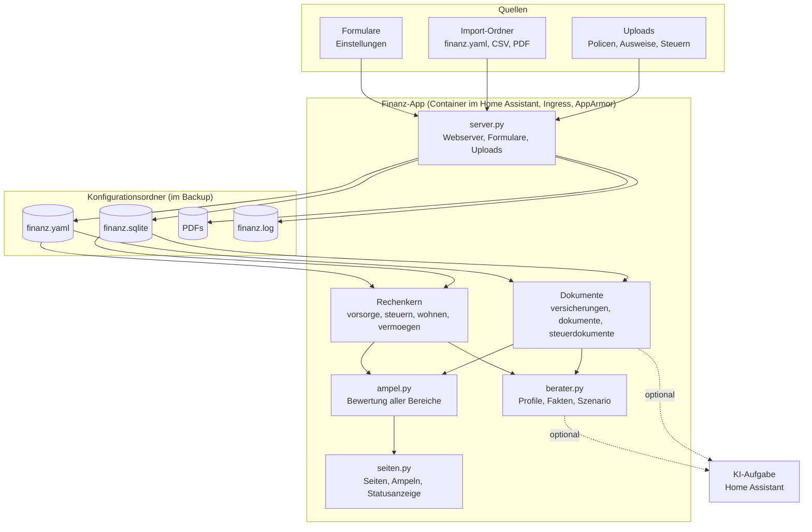

# Finanzplanung – Home-Assistant-App

Finanzplanung für einen Schweizer Haushalt (Ehepaar, Konkubinat oder Einzelperson) als App im Home Assistant:
Vorsorge, Steuern, Wohneigentum, Vermögen, Versicherungen und Anlageberater – mit Ampeln, die zeigen, wo etwas
ansteht. Bedienung und Rechenmodell siehe [finanz/DOCS.md](finanz/DOCS.md) (in Home Assistant unter «Dokumentation»),
Änderungen siehe [finanz/CHANGELOG.md](finanz/CHANGELOG.md).

> Keine Anlage-, Steuer- oder Rechtsberatung. Schätzungen mit vereinfachten Modellen.

## Funktionen

| Bereich | Inhalt |
|---|---|
| Übersicht | Ampeln pro Bereich, Kennzahlen, Hinweise, Statuszeile, Vermögensverlauf, Einkommen im Ruhestand |
| Vorsorge | AHV (Rentenskala 44, Splitting, Erziehungsgutschriften, Plafond, 13. Rente), Pensionskasse (Ausweis-Prognose oder BVG-Minimum, Einkäufe, Sperrfrist), Säule 3a, Pensionslücke; Vorsorgeausweis, 3a- und IK-Auszug hochladen |
| Steuern | Bundessteuer nach Tarif, Kanton als Kurve durch die letzte Veranlagung, Konkubinat getrennt, 3a und PK-Einkauf simulieren, Kapitalbezug gestaffelt; Steuererklärungen und Veranlagungen hochladen, Mehrjahresvergleich, Grenzsteuersatz, Abgleich |
| Wohnen | Tragbarkeit, maximaler Kaufpreis, Amortisation bis zur Fälligkeit (inkl. verpfändeter 3a/3b), Wegfall des Eigenmietwerts ab 2029 |
| Vermögen | Konten und Saldi, Bank-Import aus E-Banking-CSV, eigene Listen, Nettovermögen und Verlauf |
| Versicherungen | Policen als PDF oder Liste, Erkennung, Deckungscheck, Kündigungstermine, Risiko Invalidität und Tod |
| Szenarien | PK-Einkäufe optimal auf Jahre verteilen; Hypothekar-Strategie (SARON, Fest, Staffelung, Zinsszenarien); Vergleich verheiratet ↔ Konkubinat |
| Erinnerungen | 3a, PK-Einkauf, Krankenkasse, Kündigungsfristen, Steuererklärung, Hypothek, eigene; optional Benachrichtigung über Home Assistant |
| Berater | Sechs Beraterprofile mit Situation und Fakten aus der Planung; über die KI-Aufgabe von Home Assistant oder zum Kopieren |
| Einstellungen | Formular, YAML-Editor, Import-Ordner, Export; Protokoll und Änderungen in der App |

## Installation

Home Assistant → Einstellungen → Apps → App-Store → ⋮ → Repositories → `https://github.com/khu1985/finanz-ha`
hinzufügen, dann «Finanzplanung» installieren und starten. Die App erscheint als «Finanzen» in der Seitenleiste.

**Vorabversion testen:** Statt der Adresse oben `https://github.com/khu1985/finanz-ha#tests` hinzufügen. Damit
installiert Home Assistant den Stand des Branches `tests` (siehe [Entwicklung](#entwicklung)). Beide Fassungen lassen
sich nebeneinander installieren; jede hat ihren eigenen Konfigurationsordner.

## Persönliche Daten

Persönliche Daten (Löhne, Guthaben, Saldi, Policen, Ausweise, Steuerunterlagen) gehören **nicht** in dieses
Repository. Sie werden in der App erfasst oder in den Import-Ordner `/addon_configs/<…>_finanz/import/` kopiert
(Samba, File editor, Studio Code Server). Die App liest `finanz.yaml`, `vermoegen*.csv`, `versicherungen*.csv` und PDFs
beim Start oder per Knopf ein. Alles liegt danach im Konfigurationsordner der App und ist im Home-Assistant-Backup
enthalten. `.gitignore` schliesst die Datendateien aus; die Tests arbeiten nur mit erfundenen Daten.

## Architektur

Die App läuft als Container im Home Assistant und erscheint über Ingress als Seite in der Seitenleiste.
Ohne KI braucht sie kein Internet; mit KI geht der Auftrag über die KI-Aufgabe (`ai_task`) von Home Assistant.



| Datei | Aufgabe |
|---|---|
| `finanz/config.yaml` | App-Definition: Version, Ingress, AppArmor, Zugriff auf den Konfigurationsordner |
| `finanz/apparmor.txt` | AppArmor-Profil |
| `finanz/Dockerfile`, `build.yaml`, `run.sh` | Image (Python 3.12, Alpine) und Start |
| `finanz/app/server.py` | Webserver (Standardbibliothek), Ingress-Pfad, Formulare, Uploads, Protokoll |
| `finanz/app/seiten.py` | Alle Seiten, Navigation, Statusanzeige, mobile Darstellung |
| `finanz/app/ampel.py` | Ampeln für alle Bereiche und die Navigation |
| `finanz/app/vorsorge.py` | AHV, Pensionskasse, 3a, Pensionslücke |
| `finanz/app/steuern.py` | Bundessteuertarif, Kantonssteuer-Kurve, Steuereinheiten (Ehe/Konkubinat), Kapitalbezug |
| `finanz/app/wohnen.py` | Tragbarkeit, maximaler Kaufpreis, Eigenmietwert |
| `finanz/app/vermoegen.py` | Konten, Saldi, CSV-Import, Verlauf |
| `finanz/app/versicherungen.py` | Policen, Erkennung, Deckungscheck, Kündigungstermine, Risiko, KI-Aufgabe |
| `finanz/app/dokumente.py` | Vorsorgeausweis, 3a- und IK-Auszug |
| `finanz/app/steuerdokumente.py` | Steuererklärung, Veranlagung, Mehrjahresvergleich, Abgleich |
| `finanz/app/hypothek.py` | Hypothekar-Strategie über Zinsszenarien |
| `finanz/app/bankimport.py` | Kontoauszüge aus dem E-Banking einlesen |
| `finanz/app/erinnerungen.py` | Erinnerungen, erledigt-Status, Benachrichtigung über Home Assistant |
| `finanz/app/szenarien.py` | PK-Einkauf-Optimierung, Vergleich verheiratet ↔ Konkubinat |
| `finanz/app/berater.py` | Beraterprofile, Fakten, Amortisations-Szenario, Beratungen |
| `finanz/app/importordner.py` | Import-Ordner für persönliche Dateien |
| `finanz/app/konfig.py`, `meta.py` | Konfiguration laden/speichern, Version, Changelog, Protokoll |
| `finanz/app/diagramme.py` | Linien- und Säulendiagramme als SVG |
| `finanz/app/default_config.yaml` | Vorlage mit Musterhaushalt und Kennzahlen 2026 |

## Entwicklung

| Branch | Zweck | In Home Assistant |
|---|---|---|
| `main` | stabile Fassung | `https://github.com/khu1985/finanz-ha` |
| `tests` | Vorabversion zum Ausprobieren | `https://github.com/khu1985/finanz-ha#tests` |

Ablauf für Änderungen:

1. Änderung auf `tests` committen, Version in `finanz/config.yaml` erhöhen und `finanz/CHANGELOG.md` ergänzen.
2. GitHub Actions prüfen den Stand (siehe unten).
3. In Home Assistant die Vorabversion aktualisieren und ausprobieren.
4. Wenn alles passt, `tests` nach `main` übernehmen (Fast-forward oder Pull Request) – die stabile Fassung erhält das Update.

Home Assistant bietet ein Update nur an, wenn die Version in `finanz/config.yaml` höher ist.

## Tests

`tests/` prüft Rechenkern, Dokumenterkennung und Web-App mit erfundenen Daten, z. B. Eckwerte der Rentenskala,
Ehepaar-Plafond und Konkubinat, Bundessteuer an Tarifgrenzen, Kantonssteuer-Kurve, Staffelung, Tragbarkeit,
Erkennung von Policen, Vorsorgeausweisen und Steuerdokumenten aus erzeugten PDFs, Kündigungsfristen nach VVG,
Ampel-Schwellen, PK-Einkauf-Optimierung, Heiratsvergleich, Hypothekar-Strategie, Bank-Import (Beispielauszüge in
`tests/bank/`), Erinnerungen und Benachrichtigungen, Import-Ordner sowie alle Seiten und Uploads hinter
einem Ingress-Pfad.

GitHub führt die Tests bei jedem Push auf `main` und `tests` und bei jedem Pull Request aus
(`.github/workflows/tests.yml`):

- **Wie im Home Assistant:** Python 3.12 mit den Paketversionen des App-Images
- **Neueste Paketversionen:** zeigt früh, wenn künftige Versionen etwas brechen
- **App-Image bauen und starten:** baut das Docker-Image, startet es und ruft Übersicht, Änderungen und Protokoll ab

Lokal:

```sh
pip install -r finanz/requirements.txt pytest reportlab
python3 -m pytest tests
FINANZ_DATA=/tmp/finanz PORT=8099 python3 finanz/app/server.py   # App unter http://localhost:8099
```

Das AppArmor-Profil lässt sich nur in Home Assistant prüfen; nach Änderungen daran zuerst über `tests` ausprobieren.
