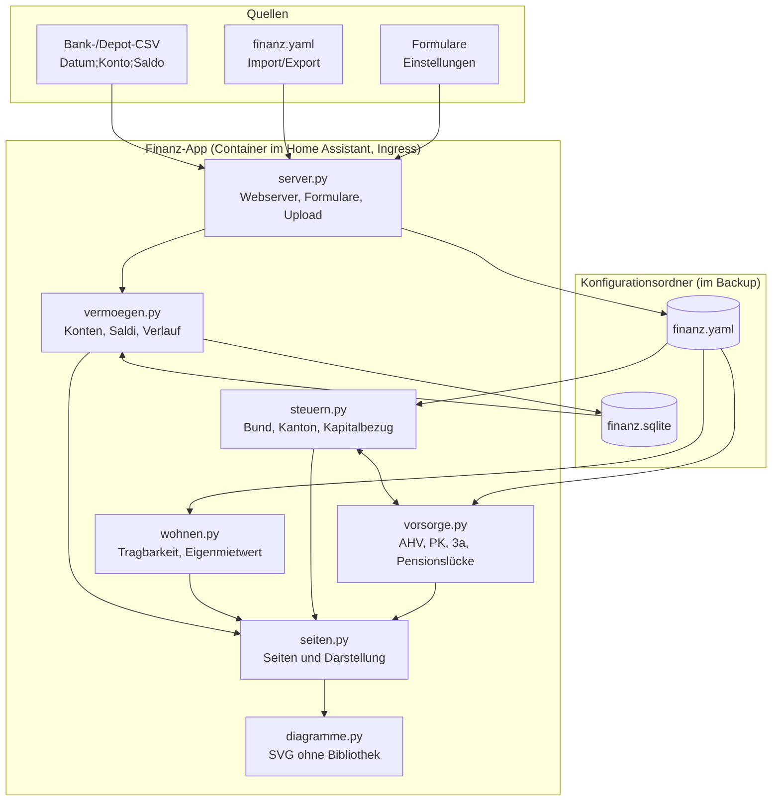

# Finanzplanung – Home-Assistant-App

Finanzplanung für einen Schweizer Haushalt (Ehepaar, Konkubinat oder Einzelperson): AHV, Pensionskasse, Säule 3a,
Pensionslücke, Steuern (Bund nach Tarif, Kanton als Näherung, getrennt bei Konkubinat), Kapitalbezug gestaffelt,
Tragbarkeit, Amortisation bis zur Fälligkeit, Wegfall des Eigenmietwerts ab 2029, Vermögensverlauf, Versicherungen
mit Deckungscheck und Risiko-Analyse, Vorsorgedokumente hochladen und Anlageberater-Profile (optional mit KI). Bedienung und Rechenmodell siehe
[finanz/DOCS.md](finanz/DOCS.md) (in Home Assistant unter «Dokumentation»).

> Keine Anlage-, Steuer- oder Rechtsberatung. Schätzungen mit vereinfachten Modellen.

## Installation

Home Assistant → Einstellungen → Apps → App-Store → ⋮ → Repositories → `https://github.com/khu1985/finanz-ha`
hinzufügen, dann «Finanzplanung» installieren und starten. Die App erscheint als «Finanzen» in der Seitenleiste.

Persönliche Daten (Löhne, Guthaben, Saldi, Policen, Ausweise) gehören nicht in dieses Repository. Sie werden in der
App erfasst oder in den Import-Ordner `/addon_configs/<…>_finanz/import/` kopiert (siehe DOCS.md).

## Architektur

Die App läuft als Container im Home Assistant und erscheint über Ingress als Seite in der Seitenleiste.
Alle Daten liegen im Konfigurationsordner der App und sind damit im Home-Assistant-Backup enthalten.
Ohne KI braucht die App kein Internet; mit KI geht der Auftrag über die KI-Aufgabe von Home Assistant.

| Datei | Aufgabe |
|---|---|
| `finanz/app/server.py` | Webserver (nur Standardbibliothek), Ingress-Pfad, Formulare, Datei-Upload, Protokoll |
| `finanz/app/seiten.py` | Seiten Übersicht, Vorsorge, Steuern, Wohnen, Vermögen, Einstellungen |
| `finanz/app/vorsorge.py` | AHV (Skala 44, Splitting, Erziehungsgutschriften, Plafond, 13. Rente), PK-Projektion, 3a, Pensionslücke |
| `finanz/app/steuern.py` | Bundessteuertarif, Kantonssteuer-Näherung, Abzüge simulieren, Kapitalbezug gestaffelt |
| `finanz/app/wohnen.py` | Tragbarkeit, maximaler Kaufpreis, Systemwechsel Eigenmietwert |
| `finanz/app/vermoegen.py` | SQLite mit Konten und Saldi, CSV-Import, Nettovermögen, Verlauf |
| `finanz/app/versicherungen.py` | Policen hochladen/importieren, Erkennung, Deckungscheck, Kündigungstermine, Risiko, KI-Aufgabe |
| `finanz/app/dokumente.py` | Vorsorgeausweis, 3a- und IK-Auszug erkennen und übernehmen |
| `finanz/app/berater.py` | Beraterprofile, Fakten, Amortisations-Szenario, Aufträge und Antworten |
| `finanz/app/importordner.py` | Import-Ordner für persönliche Dateien |
| `finanz/apparmor.txt` | AppArmor-Profil |
| `finanz/app/diagramme.py` | Linien- und gestapelte Säulendiagramme als SVG |
| `finanz/app/konfig.py` | finanz.yaml laden (fehlende Schlüssel aus der Vorlage), speichern mit Backup |
| `finanz/app/default_config.yaml` | Vorlage mit Musterhaushalt und Kennzahlen 2026 |

## Tests

`tests/` prüft Rechenkern und Web-App mit erfundenen Daten, z. B. Eckwerte der Rentenskala,
Ehepaar-Plafond, BVG-Minimum, Bundessteuer an Tarifgrenzen, Staffelung (gleiches Kapital, weniger Steuer),
Tragbarkeit am maximalen Kaufpreis, CSV-Import und alle Seiten hinter einem Ingress-Pfad.

GitHub führt die Tests bei jeder Änderung aus (`.github/workflows/tests.yml`): mit Python 3.12 wie im
App-Image, mit den neuesten Paketversionen und durch Bauen und Starten des Docker-Images.

Lokal: `python3 -m pytest tests`. Die App lokal starten:
`FINANZ_DATA=/tmp/finanz PORT=8099 python3 finanz/app/server.py`.

## Änderungen

Siehe [finanz/CHANGELOG.md](finanz/CHANGELOG.md).
