# Finanzplanung

Finanzplanung eines Schweizer Haushalts – Ehepaar, Konkubinat oder Einzelperson – direkt im Home Assistant:
Vorsorge, Steuern, Wohneigentum, Vermögen, Versicherungen, Szenarien und Anlageberater. Die App erscheint als
«Finanzen» in der Seitenleiste; Ampeln zeigen auf einen Blick, wo etwas ansteht.

**Keine Anlage-, Steuer- oder Rechtsberatung.** Die Ergebnisse sind Schätzungen mit vereinfachten Modellen.
Für Entscheide (PK-Einkauf, Kapitalbezug, Heirat, Hauskauf) die Werte mit Vorsorgeausweis, IK-Auszug,
kantonalem Steuerrechner oder einer Fachperson prüfen.

## Inhalt

1. [Erste Schritte](#erste-schritte)
2. [Bedienung](#bedienung)
3. [Seiten](#seiten)
4. [Vorsorge](#vorsorge) · [Steuern](#steuern) · [Wohnen](#wohnen) · [Vermögen](#vermögen) · [Budget](#budget-und-cashflow) ·
   [Versicherungen](#versicherungen) · [Finanzplan](#finanzplan) · [Szenarien](#szenarien) · [Anlageberater](#anlageberater) ·
   [Nachlass](#nachlass-und-absicherung) · [Erinnerungen](#erinnerungen) · [Sensoren](#sensoren-in-home-assistant)
5. [Jahresbericht](#jahresbericht) · [Fremdwährungen](#konten-in-fremdwährung) · [Liegenschaft](#liegenschaft-wert-und-erneuerung) · [Kinder](#kinder) · [Teilzeit](#teilzeit-und-kinderbetreuung) · [E-Steuerauszug](#e-steuerauszug-der-bank) · [Steuererklärung](#steuererklärung-vorbereiten) · [Verfügungen](#verfügungen) · [Fragebögen](#fragebögen-zum-nachlass) · [Notfallordner](#notfallordner) · [Zuzug in die Schweiz](#zuzug-in-die-schweiz) · [Nicht verheiratet (Konkubinat)](#nicht-verheiratet-konkubinat)
6. [Ampeln](#ampeln) · [Plausibilität](#plausibilität-der-einstellungen) · [Vorschläge](#vorschläge-für-die-weiterentwicklung) · [Dokumente verwalten und löschen](#dokumente-verwalten-und-löschen) · [Dokumente neu sichten](#dokumente-neu-sichten) · [Uploads und Texterkennung](#uploads-und-dateigrösse)
7. [Persönliche Daten und Import-Ordner](#persönliche-daten-und-import-ordner)
8. [Konfiguration](#konfiguration)
9. [Rechenmodell](#rechenmodell)
10. [KI (optional)](#ki-optional)
11. [Daten, Sicherung und Sicherheit](#daten-sicherung-und-sicherheit)
12. [Fehlersuche](#fehlersuche)

## Erste Schritte

1. **Daten erfassen** – eine der beiden Varianten:
   - **Einstellungen** öffnen und die Musterwerte im Formular ersetzen: pro Person Vorname (Anzeige in der App) und
     Nachname (für Verfügungen und Schreiben), Geburtsdatum, Bruttolohn,
     Sparpotenzial, AHV-Beitragsjahre, Werte aus dem Vorsorgeausweis, 3a; Steuern aus der letzten Veranlagung;
     Wohneigentum.
   - Eine vorbereitete `finanz.yaml` unter **Einstellungen → Experte** einfügen oder in den
     [Import-Ordner](#persönliche-daten-und-import-ordner) kopieren.
2. **Dokumente hochladen** – die App liest die Werte aus und übernimmt sie auf Knopfdruck:
   - Vorsorgeausweise, 3a- und IK-Auszüge unter **Vorsorge**
   - Steuererklärungen, Veranlagungen und den E-Steuerauszug der Bank unter **Steuern**
   - Versicherungspolicen unter **Versicherungen** (oder eine Liste als CSV)
3. **Vermögen** erfassen: Kontoauszüge aus dem E-Banking als camt.053 (XML/ZIP) oder CSV importieren, Saldi von Hand
   oder als eigene Liste (`Datum;Konto;Saldo;Art;Person`).
4. **Kinder** auf der Seite Kinder erfassen (Geburtsdatum, Kind von, Betreuung).
5. Die **Übersicht** und ihre Ampeln zeigen, wo etwas zu tun ist. Werte mit «TODO» in der Konfiguration sind
   Platzhalter; ihre Zahl steht in der Statuszeile.

Geplante PK-Einkäufe, verpfändete Vorsorge oder eine weitere Person werden im YAML-Editor erfasst, z. B.:

```yaml
personen:
  - name: Anna
    nachname: Muster
    pk:
      einkauf_geplant:
        - {jahr: 2027, betrag: 20000}
```

## Bedienung

- **Menü** in Gruppen – Überblick (Übersicht, Jahresbericht, Berater), Planung (Vorsorge, Steuern, Steuererklärung,
  Wohnen, Kinder, Finanzplan, Szenarien, Nachlass, Verfügungen, Notfallordner), Bestand (Vermögen, Budget, Versicherungen), App
  (Einstellungen, Dokumente, Vorschläge, Protokoll, Änderungen). Auf grossen Bildschirmen als Seitenleiste,
  auf Tablets als wischbare Leiste, auf dem Handy hinter dem Knopf «Menü». Ein farbiger Punkt markiert Seiten mit
  gelber oder roter Ampel; beim Protokoll steht die Zahl der Warnungen von heute.
- **Version** neben «Finanzen» öffnet die Änderungen.
- **Darstellung:** Der Knopf daneben wechselt zwischen Auto (wie das Gerät), Hell und Dunkel; die Wahl bleibt im
  Browser gespeichert.
- **Statusanzeige:** Ladebalken beim Seitenwechsel; bei Uploads, Importen, KI und Beratern ein Hinweisfenster mit
  Spinner, Anzahl und Grösse der Dateien. Knöpfe sind während der Verarbeitung gesperrt.
- **Statuszeile** auf der Übersicht: Stand der Saldi, Anzahl Verträge und Dokumente, offene TODO, wartende Dateien im
  Import-Ordner, KI an/aus, Warnungen von heute.
- **Protokoll:** neueste Einträge zuerst, Filter nach Stufe, Download. Die Stufe für neue Einträge steht in der
  App-Konfiguration (`log_level`).
- **Handy:** Kennzahlen zweispaltig, breite Tabellen als Karten, grosse Bedienelemente.

## Seiten

| Seite | Inhalt |
|---|---|
| Jahresbericht | Vergleich mit dem Vorjahr, das Wichtigste, Ampeln, Massnahmen der nächsten 12 Monate, Drucken |
| Übersicht | Ampeln, anstehende Erinnerungen, Kennzahlen, Hinweise, Statuszeile, Vermögensverlauf, Einkommen im Ruhestand |
| Vorsorge | Pensionslücke, AHV, Pensionskasse, 3a, Vorsorgedokumente |
| Steuern | Steuern heute (pro Steuererklärung), Abzüge simulieren, Steuerdokumente mit Vergleich und Abgleich, E-Steuerauszug der Bank, Kapitalbezug |
| Wohnen | Tragbarkeit, maximaler Kaufpreis, Wegfall Eigenmietwert, Amortisation bis zur Fälligkeit, Wert der Liegenschaft und Erneuerungsplanung |
| Kinder | Kinder erfassen, Zeitachse mit Zulagen, Betreuung und Steuerwirkung, Hinweise |
| Vermögen | Konten (auch in Fremdwährung) mit eigener Seite zum Verwalten, Saldi, Wertschriften pro Position, Anlage-Check, Bank-Import (camt.053, CSV), eigene Liste, Verlauf, Aufteilung nach Art |
| Budget | Einnahmen, Ausgaben nach Kategorie und Monat, Sparquote, Vergleich mit dem Sparpotenzial, wiederkehrende Zahlungen, eigene Regeln |
| Versicherungen | Verträge, Deckungscheck, Kündigungstermine, Krankenkasse (Franchise, Modell, alle Kassen im Vergleich), Risiko Invalidität und Tod, Prämien |
| Finanzplan | Jahr für Jahr bis 95, Bandbreite aus 1000 simulierten Verläufen, Wahrscheinlichkeit, dass das Geld reicht, tragbarer Bedarf |
| Szenarien | PK-Einkauf optimieren, Teilzeit und Kinderbetreuung, Frühpensionierung, Hypothekar-Strategie, Vergleich verheiratet ↔ Konkubinat (mit Individualbesteuerung) |
| Steuererklärung | Checkliste pro Steuerjahr mit Belegen und Werten aus der App, Saldi per 31.12., Vorjahr |
| Nachlass | Was der Partner im Todesfall erhält, Erbschaftssteuer, Checkliste Testament, Begünstigungen, Vorsorgeauftrag, Fragebögen pro Punkt |
| Verfügungen | Testament, Vorsorgeauftrag, Patientenverfügung, Konkubinatsvertrag, 3a-Begünstigung, Ehevertrag, Erbvertrag, Darlehen, Schenkung bzw. Erbvorbezug mit Fragen und Optionen entwerfen; Pflichtteile, Verteilung, Text mit vollen Namen zum Abschreiben bzw. Drucken |
| Notfallordner | Druckbare Übersicht für Angehörige: Konten, Vorsorge, Policen, Kontakte, Ablageorte, erste Schritte, Antworten der Fragebögen, Meldeliste für den Todesfall |
| Berater | Situation, Beraterprofile, Amortisations-Szenario, Beratungen |
| Einstellungen | Formular mit Plausibilitäts-Ampel pro Feld, Namen aufteilen, Import-Ordner, Dokumente neu sichten, YAML-Editor, Export und Import von `finanz.yaml` |
| Dokumente | Alle hochgeladenen Dokumente und Buchungen: Datei öffnen, Text-Ampel, Duplikate, einzeln, ausgewählt oder alle löschen |
| Vorschläge | Aus den eigenen Daten abgeleitete, anonymisierte Verbesserungsvorschläge für die App, wahlweise mit anonymisierten Textauszügen; erledigte werden selbst abgehakt; kopieren, herunterladen oder als GitHub-Issue öffnen |
| Protokoll | Log der App (Aktionen, Warnungen, Fehler), filterbar, rotiert bei 1 MB |
| Änderungen | Changelog der installierten Version |

## Vorsorge



- **AHV** pro Person mit Beitragsjahren, Erziehungsjahren, Durchschnittseinkommen, Rente pro Monat und Jahr
  (13. AHV-Rente), bei Ehepaaren plafoniert.
- **Pensionskasse:** Verlauf des Altersguthabens bis zur Pensionierung, Einkäufe, Kapitalbezug, Rente. Ist ein
  Alterskapital laut Vorsorgeausweis erfasst, rechnet die App mit dieser Prognose (plus geplante Einkäufe).
- **Säule 3a:** Kapital bei Pensionierung und Steuerersparnis der Beiträge.
- **Pensionslücke:** AHV + PK-Renten + Kapitalverzehr gegenüber dem Bedarf im Ruhestand.
- **Vorsorgedokumente:** Vorsorgeausweis, 3a-Auszug, 3b-Police bzw. 3b-Konto und IK-Auszug als PDF hochladen
  (mehrere Dateien auf einmal möglich). Erkannt werden u. a. Altersguthaben, Einkaufspotenzial, Prognose mit 65,
  Sparbeitrag, Umwandlungssatz, Invaliden-, Partner- und Waisenrenten, Todesfallkapital, Jahreslohn, 3a-Saldo,
  3b-Rückkaufswert bzw. -Guthaben, Prämie, Erlebensfall- und Todesfallkapital sowie AHV-Beitragsjahre. Das
  3b-Guthaben wird als Saldo eines Vorsorge-Kontos unter «Vermögen» übernommen (Konto wählbar; eine gleichnamige
  verpfändete 3b unter Wohnen wird nachgeführt), die 3b-Todesfallleistung als «Todesfallkapital Policen». Auf der Dokumentseite stehen
  erkannte und heutige Werte nebeneinander; Person wählen, Werte prüfen, übernehmen. Dazu eine Einschätzung
  (Ersparnis eines Einkaufs, Umwandlungssatz, Beitragslücken, Partnerrente im Konkubinat).

## Steuern



- **Steuern heute:** Bund nach Tarif, Kanton und Gemeinde als Kurve durch die letzte Veranlagung, Grenz- und
  effektiver Steuersatz – bei Konkubinat pro Steuererklärung.
- **Abzüge simulieren:** 3a-Maximum und PK-Einkäufe pro Person mit Ersparnis; der optimale Einkauf über mehrere
  Jahre steht unter [Szenarien](#szenarien).
- **Steuerdokumente:** Steuererklärungen, Veranlagungsverfügungen und Steuerrechnungen hochladen (auch mehrere
  Jahre). Erkannt werden Steuerperiode, Person, steuerbares Einkommen Kanton und Bund, steuerbares Vermögen,
  Staats-, Gemeinde- und Bundessteuer, Lohn, Eigenmietwert, Mietertrag und Abzüge (3a, PK-Einkauf, Schuldzinsen,
  Liegenschaftsunterhalt, Berufskosten, Kinder). Daraus entstehen:
  - **Vergleich pro Person** über die Jahre (Veranlagung vor Erklärung) mit Veränderung zum Vorjahr
  - **Grenzsteuersatz** Kanton + Gemeinde aus zwei Veranlagungen (Δ Steuer ÷ Δ Einkommen), übernehmbar
  - **Abgleich** Erklärung ↔ Veranlagung: Korrekturen der Steuerverwaltung (Einsprache meist innert 30 Tagen)
  - **Hinweise:** 3a offen, PK-Einkauf ungenutzt, Unterhalt Pauschale vs. effektiv, Eigenmietwert bis 2028,
    Mietertrag, Kinderabzug im Konkubinat
  - **Übernahme** in die Steuer-Einstellungen der Person, Eigenmietwert und 3a
- **Kapitalbezug PK und 3a:** alles im Pensionsjahr gegenüber gestaffelt, pro Steuereinheit.
- **Vermögenssteuer:** Betrag aus der Veranlagung (`steuern.vermoegenssteuer`, auch aus Steuerdokumenten) oder
  steuerbares Vermögen × `kennzahlen.vermoegen_promille` ‰. «Steuern total pro Jahr» = Einkommens- plus Vermögenssteuer.

## Wohnen

Tragbarkeit nach Bankenpraxis (Mieteinnahmen zu 80 %), Belehnung, maximal tragbarer Preis, effektive Kosten,
Wirkung des Wegfalls des Eigenmietwerts ab 2029 und – mit Fälligkeit der Hypothek – das **Amortisations-Szenario**:
heute liquide Mittel (ohne die Arten unter `wohnen.nicht_antasten`) + Sparen bis zur Fälligkeit + verpfändete
3a/3b − Steuer beim Bezug − geplante PK-Einkäufe (nach Steuerersparnis) − Notreserve, verglichen mit Ziel- und
Maximal-Amortisation.

### Teilweise vermietet und Miteigentum

| Einstellung | Bedeutung |
|---|---|
| Wohnen → Eigenmietwert Staat | Eigenmietwert der **ganzen** Liegenschaft, wie wenn alles selbst bewohnt wäre |
| Wohnen → Eigenmietwert Bund | 0 = Staat × Kantonsfaktor (BL: 1,2); sonst eigener Wert |
| Wohnen → Zimmer / davon dauernd nicht genutzt | Unternutzungsabzug: Eigenmietwert × ungenutzte Zimmer ÷ (Zimmer + 2 Nebenräume beim Haus bzw. + 1 bei Stockwerkeigentum) |
| Wohnen → Selbstnutzung seit | Datum für die Steuererklärung |
| Wohnen → Vermieteter Anteil % | z. B. 38 für eine Einliegerwohnung; der Eigenmietwert gilt nur für den Rest (62 %) |
| Wohnen → Mieteinnahmen/Jahr | brutto für die ganze Liegenschaft |
| Person → Anteil an der Liegenschaft % | Eigentumsanteil für getrennte Erklärungen (Konkubinat, Miteigentum); 0 = Rest zu gleichen Teilen |

Beispiel: Eigenmietwert 40'000, 38 % vermietet, Mieteinnahmen 29'760, Miteigentum je 50 % → jede Person deklariert
Eigenmietwert 12'400 (40'000 × 62 % × 50 %), Mieteinnahmen 14'880 und die Hälfte der Schuldzinsen; die
Unterhaltspauschale gilt auf Eigenmietwert und Mieteinnahmen (ohne überwälzte Nebenkosten): Bund 10 % bei Gebäuden bis
10 Jahre, sonst 20 %; BL Staat 20 % bzw. 25 %; ohne Baujahr gilt «älter als 10 Jahre». Staat und Bund werden getrennt
gerechnet (eigener Eigenmietwert und eigene Pauschale).

Unternutzung gilt nur für Zimmer, die dauernd nicht genutzt werden – nicht für Gäste-, Arbeits- oder Bastelzimmer,
nicht für Zimmer, die für ausgezogene Kinder bereitgehalten werden, und nicht für Ferien- und Zweitwohnungen; den
Nachweis erbringt die steuerpflichtige Person.
Die Seite Wohnen zeigt das heute und ab 2029: Für den vermieteten Teil bleiben Mieteinnahmen steuerbar und
Unterhalt abziehbar, Schuldzinsen nur noch im Verhältnis der vermieteten Liegenschaft zum Gesamtvermögen. Die
Steuererklärungs-Checkliste und der Nachlass rechnen mit denselben Anteilen. Beim Übernehmen aus einem
Steuerdokument rechnet die App den deklarierten Eigenmietwert und Mietertrag auf die ganze Liegenschaft hoch.

## Vermögen

Konten mit Art (Bank, Wertschriften, Krypto, Vorsorge 3b, Immobilie, Hypothek, Kredit, Sonstiges) und Person.
**Anlage-Check.** Teilt das Finanzvermögen (Konten, Depot, Krypto, Übriges) in Töpfe: Notreserve (`wohnen.reserve`,
sonst ein halber Jahresbedarf), Amortisation bei Fälligkeit (Ziel bzw. Maximum, soweit nicht aus Sparen und
verpfändeter Vorsorge gedeckt; sicher und terminiert anlegen), geplante PK-Einkäufe und den langfristigen Topf mit
Aktienquote nach Risikoprofil (tief 25 %, mittel 50 %, hoch 75 %; Renditeannahmen 2 / 3,5 / 5 %). Dazu der Anteil auf
Konten, in Aktien und Krypto (Richtwert höchstens 5 %), der mögliche Mehrertrag pro Jahr und bis zur Pensionierung,
Hinweise zu Klumpenrisiko (Arbeitgeberaktien) und Hypothekarzins. Risikoprofil und Zinsen auf der Karte einstellbar
(`anlage`). Keine Produktempfehlungen.

Saldi von Hand, als eigene Liste oder per **Bank-Import**; ein Saldo pro Konto und Tag, neuere ersetzen ältere.

**Konto verwalten:** Kontoname in der Liste anklicken (oder «Verwalten»).

| Was | Wie |
|---|---|
| Name, Art, Person, Währung, Notiz | Karte «Konto» → Speichern; beim Umbenennen wandern die Budget-Buchungen mit |
| Saldo korrigieren | in der Tabelle «Saldi» Datum oder Betrag ändern → Änderungen speichern |
| Saldo löschen | Kästchen ankreuzen → Ausgewählte löschen |
| Saldo nachtragen | letzte Zeile «neu» ausfüllen → Änderungen speichern |
| doppelte Konten | «Zusammenführen» ins richtige Konto: Saldi und Buchungen wandern mit (am selben Tag gilt das Zielkonto, gleiche Buchungen zählen einmal) |
| Konto geschlossen | «Als aufgelöst markieren»: Saldo 0 ab dem Datum, Verlauf bleibt, Konto steht eingeklappt unter «Aufgelöste Konten» |
| Konto löschen | auf der Kontoseite oder mehrere per Kästchen in der Liste – löscht Saldi und Buchungen |

**Bank-Import.** Kontoauszug im E-Banking als CSV exportieren (Raiffeisen, UBS, ZKB, PostFinance, Kantonalbanken,
Migros Bank, neon, Yuh u. a.) und unter «Vermögen → Bank-Import» hochladen oder als `bank*.csv` bzw. `konto*.csv` in den
Import-Ordner legen. Die App erkennt Kodierung, Trennzeichen, Vorspann-Zeilen, IBAN, Bank und die Spalten (Datum,
Saldo, Betrag oder Gutschrift/Belastung) und übernimmt den letzten Saldo jedes Monats. Der Kontoname entsteht
automatisch (z. B. «Raiffeisen …7890») oder wird angegeben. Fehlt die Saldo-Spalte, den heutigen Kontostand als
Endsaldo angeben; die App rechnet die Monatssaldi aus den Beträgen zurück. Hypotheken und Kredite zählen
negativ. Das freie Vermögen (ohne Immobilie und Hypothek) fliesst in den Kapitalverzehr im Ruhestand.

**camt.053 (ISO 20022).** Genauer als CSV ist der Export im Bankformat camt.053 (im E-Banking meist unter «Export»
bzw. «Kontoauszug als XML/camt», oft mehrere Tagesauszüge als ZIP). Die App liest XML und ZIP direkt (auch camt.052
und camt.054, alle Versionen): Buchungsdatum, Betrag mit Soll/Haben, Gegenpartei und Mitteilung pro Buchung,
Sammelaufträge aufgeteilt in Einzelzahlungen, vorgemerkte Buchungen nicht gezählt, doppelte Tagesauszüge nur einmal.
Die Monatssaldi kommen aus dem Schlusssaldo. Im Import-Ordner als `bank*.xml`, `konto*.zip` oder `camt*.zip`.

### Wertschriften pro Position

Mit dem E-Steuerauszug (XML) kommen die Titel jedes Depots mit Stückzahl, Kurs und Wert per 31.12. dazu; sonst eine
eigene Liste unter «Vermögen → Wertschriften» bzw. als `depot*.csv` im Import-Ordner
(`Datum;Depot;ISIN;Name;Kategorie;Währung;Menge;Kurs;Wert CHF`, Kategorie z. B. SHARE, FUND, BOND).

| Anzeige | Wie |
|---|---|
| Aufteilung | nach Anlageklasse (Aktien, Obligationen, Immobilien, Rohstoffe, Geldmarkt), Region und Währung; bei Fonds aus dem Namen geschätzt («World», «Emerging», «SPI», «Bond» …) |
| Rendite | Wertänderung plus Erträge gegenüber dem Vorjahres-Stichtag, nur bei gleicher Stückzahl |
| Kosten | laufende Fondskosten (TER) pro ISIN eintragen (`wertschriften.ter`); Einzeltitel ohne Fondskosten |
| Hinweise | Einzeltitel über 10 %, mehr als 60 % Fremdwährung oder Schweiz, Fonds ohne TER, Kosten über 0,6 % |

Mit Positionen rechnet der Anlage-Check mit der echten Aktienquote statt mit dem ganzen Depot. Kurse in Echtzeit
gibt es nicht – Stand ist der Stichtag des Imports.

## Budget und Cashflow

Der Bank-Import (Seite Budget, Vermögen oder Import-Ordner) speichert neben den Monatssaldi die einzelnen Buchungen;
ein erneuter Import desselben Auszugs fügt nichts doppelt ein. Am besten 12 Monate aller Konten importieren, über die
Einnahmen und Ausgaben laufen.

- **Kategorien** über Stichworte im Buchungstext: Lohn, Wohnen (Hypothek, Miete, Energie, Gebühren), Krankenkasse,
  Versicherungen, Steuern, Lebensmittel, Mobilität, Kinder und Betreuung, Gesundheit, Telekom und Abos, Einkäufe,
  Freizeit und Ferien, Bargeld, Kreditkarte, Spenden, Gebühren. Eigene Regeln (`budget.regeln`: Stichwort →
  Kategorie) gehen vor; häufige Buchungen ohne Kategorie lassen sich direkt zuordnen.
- **Umbuchungen** zwischen eigenen Konten (Stichwort oder gleicher Betrag mit Gegenbuchung auf einem anderen Konto
  innert 4 Tagen) zählen nicht. Einzahlungen in 3a, PK-Einkauf und Depot zählen als **Sparen**.
- **Auswertung** über die letzten vollständigen Monate (höchstens 12): Einnahmen, Ausgaben und Ersparnis pro Monat,
  Sparquote, Ausgaben nach Kategorie und Monat. Hinweise, wenn weniger oder mehr gespart wird als in der Planung
  (`personen[].sparen_monat`) oder die heutigen Ausgaben über dem Bedarf im Ruhestand liegen. «Als Sparpotenzial
  übernehmen» verteilt den gesparten Betrag nach Bruttolohn auf die Personen.
- Ampel: grün = gespart wie geplant, gelb = weniger als 90 % des Plans oder unter 6 Monaten Daten, rot = mehr
  ausgegeben als eingenommen.
- **Wiederkehrende Zahlungen:** gleiche Gegenpartei, fester Betrag und regelmässiger Abstand (wöchentlich bis
  jährlich; mindestens 4 wöchentliche, 3 monatliche bzw. vierteljährliche oder 2 halbjährliche bzw. jährliche
  Zahlungen). Liste mit Rhythmus, letztem Betrag, Betrag pro Jahr und nächster Belastung; Preisänderungen seit der
  letzten Zahlung sind markiert, passende Versicherungsverträge verknüpft. Einkäufe mit schwankenden Beträgen und
  Umbuchungen zählen nicht; Zahlungen, die seit mehr als zwei Perioden fehlen, gelten als beendet.

## Versicherungen

Policen als PDF (mehrere gleichzeitig) oder als CSV-Liste (`Versicherung;Anbieter;Betrag;Person;Summe;Notiz`). Die
Sparte wird aus Text bzw. Bezeichnung erkannt; jedes Feld lässt sich auf der Vertragsseite korrigieren.

- **Deckungscheck:** Grundversicherung pro Person und Kind, Privathaftpflicht, Hausrat, Gebäude (kantonal + privat
  ist üblich), Todesfallsumme gegenüber Hypothek und Kindern, Doppelversicherungen, Unfall in der Grundversicherung
  bei Angestellten, Franchise, Sparversicherungen, Erwerbsunfähigkeit
- **Kündigungstermine:** Grundversicherung bis 30. November auf 1. Januar, sonst auf Ablauf bzw. nach 3 Jahren
  (Art. 35a VVG). Kantonale Gebäudeversicherungen (z. B. BGV, GVZ, GVB, AGV) werden am Briefkopf erkannt und sind als
  obligatorisch und nicht kündbar vermerkt – für sie gibt es keinen Kündigungstermin
- **Krankenkasse: Franchise und Modell:** Pro Person und Kind Prämie pro Monat, Franchise, erwartete
  Gesundheitskosten (was die Grundversicherung bezahlt), Modell und Unfalldeckung eintragen (vorbelegt aus den
  KVG-Policen). Gesamtkosten = Prämie + Franchise + 10 % Selbstbehalt (höchstens 700, Kinder 350). Ohne eigene Offerten
  schätzt die App die Prämien anderer Franchisen mit dem gesetzlichen Höchstrabatt (70 % des Risikounterschieds,
  höchstens 50 % der Prämie). Ergebnis: optimale Franchise, Ersparnis, Kosten bei 0 bis 10'000 Franken
  Gesundheitskosten, ab welchen Kosten die tiefste Franchise lohnt, Hinweise zu Hausarzt/Telmed (`rabatt_modell`) und
  Unfall sistieren. Eigene Offerten unter `krankenkasse.personen[].angebote` (`{2500: 380.50}`). Wechsel bis 30. November.
- **Alle Kassen im Vergleich:** Mit «Prämien … vom BAG laden» holt die App die offiziellen Prämien aller Kassen
  (Datei Prämien_CH.csv von opendata.swiss, rund 25 MB; behalten werden nur die Prämien des Wohnkantons). Ohne
  Internet die Datei hochladen oder als `praemien*.csv` in den Import-Ordner legen. Pro Person: die fünf günstigsten
  Angebote über alle Modelle und Franchisen nach Gesamtkosten (Prämie + Franchise + Selbstbehalt bei den erwarteten
  Gesundheitskosten), das günstigste bei gleichem Modell und gleicher Franchise, die günstigste Variante bei der
  eigenen Kasse und die Ersparnis gegenüber heute. Prämienregion aus der KVG-Police oder unter Einstellungen
  (`krankenkasse.region`); Altersklasse (Kind, 19–25, ab 26) aus dem Geburtsdatum im Prämienjahr.
- **Krankenkassen-Policen:** Policen mit Grund- und Zusatzversicherung im gleichen PDF werden seitenweise gelesen
  (Monatsprämie, Modell, Franchise, Unfalldeckung und Unfallanteil, versicherte Person und Geburtsdatum,
  Versicherten-Nr., gültig ab, erste Anlaufstelle, Prämienregion); die Zusatzversicherung wird ein eigener Vertrag
  mit Produkten und Rabatten. Die Grundversicherung geht beim Hochladen direkt in den Krankenkassen-Rechner (ein Kind
  unter anderem Namen wird dem einzigen Kind ohne Police zugeordnet). Die Karte zeigt alle Policen mit Grund- und
  Zusatzprämien sowie Empfehlungen: günstigeres Modell bei der gleichen Kasse, Frist 30.11., Unfalldeckung
  (8-Stunden-Regel), Modelle für Kinder, Zusatzversicherungen erst nach Zusage der neuen Kasse kündigen,
  Zahnversicherung für Kinder, Notfälle im Ausland.
- **Risiko Invalidität und Tod** pro Person: IV-Rente der AHV, PK und externe Policen gegenüber dem Lohn; Renten für
  Hinterbliebene und Todesfallkapital gegenüber dem Richtwert

**Invaliditätsleistungen pro Vertrag.** Auf der Vertragsseite unter «Leistungen bei Invalidität bzw.
Erwerbsunfähigkeit» (bei Erwerbsunfähigkeits-, Unfall-, Lebens- und Risikopolicen aufgeklappt): Rente pro Jahr,
Invaliditätskapital, Wartefrist, Rente bis Alter, Ursache (Krankheit und Unfall / nur Krankheit / nur Unfall),
Mindest-Invaliditätsgrad und Prämienbefreiung. Die App liest diese Angaben aus dem Vertragstext (Monatsrenten × 12,
Wartefrist in Tagen → Monate); beim Neu-Sichten werden auch bei von Hand bearbeiteten Verträgen leere Felder ergänzt,
eingetragene Werte bleiben. Die Renten laufender, einer Person zugeordneter Policen zählen in «Risiko Invalidität und
Tod» als «Extern», solange in den Einstellungen `risiko.iv_rente_extern` 0 ist; Hinweise bei Wartefrist über 24 Monaten
und bei reinen Unfallpolicen.

## Finanzplan

Jahr für Jahr von heute bis 95 (`finanzplan.bis_alter`) in heutigen Franken:

| Phase | Rechnung |
|---|---|
| bis zur Pensionierung | freies Vermögen × (1 + reale Rendite) + Sparpotenzial (`personen[].sparen_monat` × 12); PK und 3a wachsen in ihren eigenen Modellen |
| Pensionierung | Kapital aus PK und 3a nach Kapitalbezugssteuer (gestaffelt) kommt dazu – wie bei der Pensionslücke |
| Ruhestand | Entnahme = Bedarf im Ruhestand − (AHV + PK-Renten ohne Teuerungsausgleich + Renten aus dem Ausland + Kinderrenten); der Bedarf versteht sich inkl. Steuern |

**Simulation (Monte Carlo):** 1000 Verläufe mit zufälligen Jahresrenditen (lognormal; Mittelwert = Rendite des
Risikoprofils aus dem Anlage-Check minus Teuerung; Schwankung nach Aktienquote: 16 % für Aktien, 4 % für den
sicheren Teil). Ergebnis: Anteil der Verläufe, in denen das Geld bis zum Endalter reicht (Ampel grün ab 90 %, gelb
ab 70 %), Bandbreite des Vermögens (10 %, Median, 90 %), in welchem Jahr das Geld in den schlechtesten 10 % ausgeht,
und der höchste Bedarf pro Jahr, der in 90 % der Verläufe reicht. Die Simulation ist reproduzierbar (fester
Zufallsstartwert) – Änderungen am Plan zeigen so ihre echte Wirkung.

## Szenarien

**PK-Einkauf optimieren.** Person, Budget (0 = ganzes Potenzial), Zeitraum, Mindest-Ersparnis pro Franken und
Schrittweite wählen. Die App legt Schritt für Schritt dort ein, wo der nächste Franken am meisten Steuern spart
(gleiches Einkommen in jedem Jahr angenommen) – so entsteht eine gleichmässige Verteilung. Einkäufe in den 3 Jahren
vor einem geplanten Kapitalbezug sind gesperrt; Schritte unter der Mindest-Ersparnis werden nicht eingeplant.

Das Ergebnis zeigt Einkauf und Ersparnis pro Jahr, die Ersparnis des letzten Frankens (Ampel: ≥ 30 % grün,
≥ 20 % gelb), den Vorteil gegenüber «alles in einem Jahr», den Netto-Vorteil (inkl. Zins bis 65, abzüglich der
zusätzlichen Kapitalbezugssteuer) und die Kurve der Grenz-Ersparnis. «Plan übernehmen» trägt die Einkäufe unter
`pk.einkauf_geplant` ein; ein erneuter Lauf rechnet nur noch mit dem verbleibenden Potenzial.



**Frühpensionierung.** Vergleicht den Rücktritt des ganzen Haushalts mit 58 bis 65: Pensionskasse mit Guthaben bis
zum Rücktritt (Prognose der Kasse anteilig gekürzt) und einem pro Jahr vor 65 um `fruehpension.pk_kuerzung_uws`
Prozentpunkte tieferen Umwandlungssatz; AHV frühestens mit 63 (−6,8 % pro Jahr Vorbezug); bis 65 AHV-Beiträge als
Nichterwerbstätige (Schätzung aus Vermögen und Renten); Überbrückung bis zur AHV = Bedarf minus PK-Renten aus dem
Kapital; das Sparen endet mit dem Rücktritt; das restliche Kapital wird bis zum gleichen Lebensende verzehrt. Ergebnis:
Einkommen und Lücke pro Alter (Diagramm mit Bedarf) und das früheste Alter ohne Lücke.

**Hypothekar-Strategie.** Vergleicht für die Hypothek ab Fälligkeit (nach dem Amortisations-Szenario) SARON,
Festhypotheken und Mischungen bzw. Staffelungen über drei SARON-Szenarien (tief, basis, stress; Zielniveau und
Anstiegsjahre einstellbar). Die SARON-Hypothek kostet SARON + Marge; eine Festhypothek läuft zum heutigen Satz und
wird bei Ablauf zum SARON des Verlängerungsjahres plus der heutigen Laufzeitprämie verlängert. Ergebnis: Zinskosten
über den Horizont je Szenario, höchste Jahreskosten im Stress, Zinsbindung, Ampel nach Robustheit und eine Empfehlung
für maximale Sicherheit (tiefste Kosten im Stress). Dazu der «Preis der Sicherheit» gegenüber SARON, ein Richtwert für
eine Forward-Festhypothek und Hinweise zu Vorfälligkeit und Staffelung. Sätze lassen sich auf der Seite oder unter
`wohnen.strategie` (`saron`, `marge_saron`, `fest`, `szenarien`, `strategien`, `forward_aufschlag`) anpassen – eigene
Offerten eintragen.

**Marktzinsen.** Solange Wohneigentum aktiv ist, holt die App einmal am Tag beim SNB-Datenportal den SARON (täglich)
und die publizierten Hypothekarzinsen der Banken (Monatsmittel für Festhypotheken 1–15 Jahre, variable und
SARON-Hypothek); «Marktzinsen jetzt holen» geht jederzeit, `wohnen.strategie.marktzinsen: false` schaltet aus. Es
gehen keine eigenen Daten hinaus. Die Karte zeigt die aktuellen Sätze, die Entwicklung der letzten 24 Monate und vor
der Fälligkeit einen Hinweis, wenn sich die Festzinsen in drei Monaten um 0,2 Prozentpunkte oder mehr bewegt haben.

**Offerten.** Konkrete Angebote (Bank, Produkt, Zins, Datum) unter «Offerte erfassen» – Links zu Comparis, MoneyPark
und Hypotheke.ch helfen beim Suchen. Die Strategie rechnet mit dieser Rangfolge:

| Quelle | gilt |
|---|---|
| `wohnen.strategie.fest`, `saron`, `marge_saron` in den Einstellungen | immer zuerst – leeren, um Marktzinsen zu nutzen |
| eigene Offerte der letzten 90 Tage | wenn günstiger als das Marktmittel |
| SNB-Monatsmittel bzw. SARON des letzten Handelstags | sonst |
| Standardwerte der App | ohne Marktdaten |

Die Marge der SARON-Hypothek schätzt die App aus dem publizierten Mittel der SARON-Hypothek minus SARON.

**Verheiratet oder Konkubinat.** Braucht je Person eine Steuererklärung unter `steuern.personen`. Verglichen werden:

| Punkt | Annahme bei Heirat |
|---|---|
| Einkommenssteuern heute | Bund: Summe beider Einkommen, Verheiratetenabzug, Zweiverdienerabzug (50 % des tieferen Erwerbseinkommens, 8'600 bis 14'100), Versicherungsabzug Ehe, Elterntarif. Kanton: Summe mit Splitting-Divisor (`steuern.ehe_splitting_divisor`) auf dem Mittel der beiden Steuerkurven |
| AHV-Renten | Plafonierung beider Renten auf 150 % der Maximalrente |
| Kapitalbezüge | im gleichen Jahr zusammengerechnet |
| Hinterbliebene | AHV-Witwen-/Witwerrente und PK-Ehegattenrente statt nur Waisenrenten bzw. gemeldeter Lebenspartnerrente |

Dazu eine Gesamtbilanz (Steuern bis zur Pensionierung, AHV über die Ruhestandsjahre, Kapitalbezug einmalig; ohne
Teuerung und Zins) und die rechtlichen Unterschiede (Erbrecht, Pensionskasse, Güterrecht). Die Bilanz steht zweimal:
mit gemeinsamer Besteuerung bis zur Pensionierung und mit **Individualbesteuerung** ab
`kennzahlen.individualbesteuerung_ab` (Standard 2032; am 8. März 2026 angenommen, Kantone spätestens 2032). Ab dann
zählt bei den Einkommenssteuern kein Heiratsunterschied mehr; AHV-Plafond, Hinterbliebenenleistungen und Erbrecht
bleiben.

## Nachlass und Absicherung

Für jeden Todesfall (Person A stirbt, Person B stirbt) zeigt die Seite, was der überlebende Partner erhält:

| Zeile | Herkunft |
|---|---|
| Erbteil ohne / mit Testament | Konkubinat: ohne Testament nichts; mit Testament die frei verfügbare Quote (mit Kindern ½, sonst alles). Verheiratet: ½ bzw. ¾ mit Testament |
| Erbschaftssteuer | nach Wohnkanton (`nachlass.erbschaftssteuer` überschreibt); BL: Konkubinat ab 5 Jahren gemeinsamem Wohnsitz (`nachlass.zusammen_seit`) 15 % nach 30'000, sonst 30 % nach 10'000; Ehegatten befreit |
| AHV, Pensionskasse | Witwen-/Witwerrente bzw. Waisenrenten; PK-Lebenspartnerrente nur, wenn gemeldet |
| Todesfallkapital, 3a | aus Risiko-Angaben und Begünstigung |
| Liegenschaft | Anteil (Person → «Anteil an der Liegenschaft», sonst `nachlass.anteil_immobilie`) – was an die Erben auszuzahlen wäre, um die Liegenschaft zu behalten |

Die **Checkliste** pro Person (Testament, PK-Partnerschaft gemeldet, Begünstigung 3a und Policen, Vorsorgeauftrag,
Patientenverfügung, Konkubinatsvertrag, Regelung Liegenschaft, Willensvollstrecker, Notfallordner) wird unter
`nachlass.checkliste` gespeichert. Ampel: rot im Konkubinat ohne Testamente, gelb bei offenen Punkten. Keine
Rechtsberatung – Testament und Vorsorgeauftrag handschriftlich bzw. notariell errichten.

### Fragebögen zum Nachlass

Zu jedem Punkt der Checkliste gibt es einen Fragebogen (Link «Fragebogen» in der Checkliste oder
`Nachlass → Fragebögen`): je Person bzw. für den Haushalt, mit Auswahlfeldern, Datum und Freitext. Mit * markierte
Angaben sind wichtig; sind sie ausgefüllt und die Kernfrage mit «ja» beantwortet, bietet die App an, den Punkt in der
Checkliste abzuhaken.

| Bereich | Inhalt |
|---|---|
| Testament / Erbvertrag | vorhanden, Form, Datum, wo das Original liegt, Kopie, wer was erhält, zuletzt geprüft |
| Pensionskasse | Kasse, Partner gemeldet, Datum, Bestätigung, Leistungen laut Reglement, Kontakt |
| Säule 3a | Konten, Begünstigte, schriftlich festgelegt |
| Risiko- und Lebensversicherungen | Policen, Begünstigte, bestätigt |
| Vorsorgeauftrag | vorhanden, Form, beauftragte Person, Ersatz, Bereiche, Infostar, Original |
| Patientenverfügung | vorhanden, Vertretung, hinterlegt bei, Organspende, Wünsche |
| Konkubinatsvertrag (nur Konkubinat) | vorhanden, Eigentum, Darlehen, Wohnen und Trennung, Original |
| Liegenschaft | Eigentumsform, Regelung im Todesfall, Finanzierung der Auszahlung, Tragbarkeit, Dokumente |
| Willensvollstrecker | bestimmt, Name, Kontakt, Ersatz, Honorar |
| Notfallordner | wer davon weiss, Zugänge (nur Ort/Verfahren, keine Passwörter), digitaler Nachlass, Bestattung |

Die ausgefüllten Antworten stehen im **Notfallordner** unter «Testament, Vorsorgeauftrag, Begünstigungen» und
damit auch in der Druckfassung. Gespeichert unter `nachlass.fragebogen` in `finanz.yaml` (bleibt im Home Assistant
und ist im Backup enthalten).

## Anlageberater

Sechs Profile: Konservativ, Steueroptimierer, Hypothekar- und Immobilienberater, Vorsorge- und Pensionsplaner,
Wachstum, Advocatus Diaboli; eigene unter `berater.profile` (`id`, `name`, `anweisung`). Der Auftrag kombiniert das
Profil mit eurer Situationsbeschreibung (`berater.situation`), den Fakten aus der Planung (Personen, Vorsorge,
Vermögen, Liegenschaft, Amortisations-Szenario, Steuern und Steuerhistorie, Ruhestand, Versicherungen) und eurer
Frage. Mit KI geht er an die KI-Aufgabe von Home Assistant; ohne KI lässt er sich kopieren und die Antwort wieder
einfügen. Alle Beratungen bleiben gespeichert. Die Berater sind KI-Profile, keine zugelassenen Anlageberater.

## Erinnerungen



Die Übersicht zeigt anstehende Aufgaben mit Ampel (rot ≤ 7 Tage oder überfällig, gelb ≤ 30 Tage) und dem Knopf
«erledigt», der die Aufgabe bis zur nächsten Periode ausblendet:

| Erinnerung | Zeitraum | Fällig |
|---|---|---|
| 3a einzahlen (pro Person mit Lohn) | ab 15. Oktober | 20. Dezember |
| Geplanter PK-Einkauf dieses Jahres | ab 1. September | 10. Dezember |
| Krankenkasse vergleichen | 20. September bis 30. November | 30. November |
| Kündigungsfristen der Verträge | 60 Tage vorher | Fristende |
| Steuererklärung | 2 Monate vor der ordentlichen Frist | Frist des Wohnkantons bzw. gewährte Erstreckung (siehe unten) |
| PK-Einkauf prüfen (aus dem Optimierer, wenn kein Einkauf geplant) | ab 1. September | 10. Dezember |
| 3a-Lücke des Vorjahres nachzahlen (aus den Steuerdokumenten) | ab 1. September | 20. Dezember |
| Liegenschaftsunterhalt planen (bis zum Wegfall des Eigenmietwerts) | ab 1. Oktober, bis 2028 | 31. Dezember |
| Weiteres 3a-Konto eröffnen (weniger als 3 Konten) | ab 15. Oktober | 20. Dezember |
| Neue Vorsorgeausweise hochladen | Februar bis April | 31. März |
| Kennzahlen prüfen | Januar | 31. Januar |
| Hypothek vorbereiten | 36 Monate vor Fälligkeit | 12 Monate vor Fälligkeit |
| Saldi nachführen | wenn die letzten Saldi über einen Monat alt sind | – |

**Frist der Steuererklärung.** Die App kennt die ordentliche Frist und die spätestmögliche Erstreckung aller
26 Kantone (Stand Steuerjahr 2025) und nimmt den Kanton aus `haushalt.kanton`. Wo die Frist auf dem Formular steht
oder die Quellen abweichen, weist sie darauf hin. Eine abweichende Frist laut Formular unter Einstellungen →
Erinnerungen als «Frist Steuererklärung» (MM-TT) eintragen, eine gewährte Erstreckung als «Fristerstreckung bis».
Die Karte «Frist Steuererklärung» unter Steuern zeigt den Stand mit Ampel (rot ≤ 14 Tage, gelb ≤ 60 Tage).

Eigene Erinnerungen unter `erinnerungen.eigene`:

```yaml
erinnerungen:
  eigene:
    - {titel: Depot ausgleichen, datum: "06-30", wiederholung: jaehrlich, vorlauf: 14, text: "Gewichtung prüfen"}
    - {titel: Miete Einliegerwohnung prüfen, datum: "01", wiederholung: monatlich, vorlauf: 3}
    - {titel: Notar, datum: "2027-02-15", text: "Testament besprechen"}
```

**Benachrichtigung aufs Handy:** unter Einstellungen → Erinnerungen `benachrichtigung` setzen – einen Notify-Dienst
(z. B. `notify.mobile_app_iphone`) oder `persistent` für eine Meldung in Home Assistant. Die App prüft stündlich und
sendet je Erinnerung höchstens zwei Meldungen: beim Erscheinen und bei Fälligkeit.

## Sensoren in Home Assistant

Die App liefert ihre Kennzahlen als Sensoren an Home Assistant – für Dashboards, Verlauf und Automationen
(Präfix unter Einstellungen → Sensoren, Standard `finanz`):

| Sensor | Inhalt |
|---|---|
| `sensor.finanz_nettovermoegen`, `_freies_vermoegen`, `_liquiditaet` | CHF; Aufteilung nach Art als Attribut |
| `sensor.finanz_saldi_alter` | Tage seit den letzten Saldi |
| `sensor.finanz_einkommen_ruhestand`, `_pensionsluecke`, `_ersatzquote` | Ruhestand (AHV, PK, Kapitalverzehr, Lücke im Mittel und nach 20 Jahren, Teuerung als Attribute) |
| `sensor.finanz_fruehestes_pensionsalter` | frühestes Alter ohne Lücke; Einkommen je Alter als Attribut |
| `sensor.finanz_steuern_jahr`, `_grenzsteuersatz` | Steuern heute; pro Person als Attribut |
| `sensor.finanz_steuererklaerung_frist` | Datum der nächsten Frist (Kanton, Erstreckung) |
| `sensor.finanz_amortisation_verfuegbar` | bei Fälligkeit verfügbar; Ziel und Fälligkeit als Attribute |
| `sensor.finanz_versicherungspraemien`, `_krankenkasse_ersparnis` | Prämien; optimale Franchise je Person |
| `sensor.finanz_ungenutzt` | Geld ohne Zweck auf Konten; Mehrertrag und Krypto-Anteil |
| `sensor.finanz_ausgaben_monat`, `gespart_monat`, `sparquote` | Budget aus den Kontoauszügen; Einnahmen, Kategorien, Plan als Attribute |
| `sensor.finanz_ampel` | `gruen` / `gelb` / `rot`; Bereiche und Texte als Attribute |
| `sensor.finanz_handeln` | Anzahl roter Bereiche |
| `sensor.finanz_erinnerungen`, `_naechste_frist` | anstehende Erinnerungen; nächste mit Titel und Tagen |

Die Werte werden beim Start, alle 15 Minuten und nach jeder Änderung geschrieben. Über die REST-API gesetzte Zustände
überstehen keinen Neustart von Home Assistant; sie erscheinen danach spätestens nach 15 Minuten wieder. Unter
Einstellungen → Sensoren stehen Status, alle Werte und Beispiele für eine Dashboard-Karte und eine Automation.

## Jahresbericht

Die App speichert jeden Monat automatisch einen Stand (beim ersten Hintergrundlauf im Monat; «Stand jetzt speichern»
ersetzt den Stand des laufenden Monats): Nettovermögen, freies Vermögen, Konten, Wertschriften und Krypto, Schulden,
Pensionskasse, Säule 3a, Einkommen im Ruhestand, Pensionslücke (Mittel), Steuern, Budget (gespart, Sparquote,
Ausgaben) und alle Ampeln.

Die Seite **Jahresbericht** vergleicht das gewählte Jahr (laufendes Jahr: heutige Werte) mit dem letzten Stand des
Vorjahres. Gibt es für das Vorjahr keinen Stand, wird das Nettovermögen aus den Saldi per Jahresende berechnet; haben
nicht alle Konten einen Saldo per 31.12., steht ein Hinweis und der Vergleich des Nettovermögens entfällt.
«Das Wichtigste» fasst die grossen Veränderungen und Ampelwechsel in Sätzen zusammen; dazu Verlauf des
Nettovermögens, Ampeln mit Vorjahr und die Massnahmen der nächsten 12 Monate (Ampeln mit Handlungsbedarf,
Erinnerungen). «Drucken» erzeugt eine Fassung ohne Menü.

## Konten in Fremdwährung

Jedes Konto hat eine Währung (CHF, EUR, USD, GBP; in der Kontenliste unter «Vermögen» umstellbar, beim Erfassen,
im CSV als Spalte `Währung` und beim Bank-Import automatisch erkannt). Saldi bleiben in der Kontowährung gespeichert;
alle Auswertungen rechnen in Franken.

| Einstellung | Bedeutung |
|---|---|
| `waehrungen.kurse` | Franken pro Einheit, z. B. `{EUR: 0.92, USD: 0.80}`; ohne Angabe EUR 0.92 (Stand 09.11.2026) |
| `waehrungen.automatisch` | `true` = einmal pro Tag den Referenzkurs der EZB holen (frankfurter.dev; Internet nötig, es werden keine eigenen Daten gesendet) |
| `personen[].zuzug.rente_ausland_waehrung` | Währung der Rente aus dem Ausland, z. B. EUR laut Renteninformation |

Ohne Kurs rechnet die App 1:1 und zeigt einen Hinweis. Der Verlauf rechnet frühere Saldi mit dem heutigen Kurs. Der
Anlage-Check zeigt den Anteil in Fremdwährung (ab 10 % mit Hinweis auf das Währungsrisiko); die Steuer-Checkliste
erinnert an die Umrechnung zum Kurs der ESTV-Kursliste per 31.12.

## Liegenschaft: Wert und Erneuerung

Auf der Seite **Wohnen** (bzw. `wohnen.liegenschaft`):

| Feld | Bedeutung |
|---|---|
| `art` | `haus` oder `wohnung` (Stockwerkeigentum: nur eigene Teile wie Küche, Bad, Böden; Dach, Fassade, Heizung über den Erneuerungsfonds der Gemeinschaft) |
| `marktwert`, `marktwert_datum`, `wertentwicklung` | Schätzung (Bank, Schätzer) und angenommene Entwicklung pro Jahr seither; 0 = Kaufpreis |
| `neuwert` | Gebäudeversicherungswert – Basis der Richtwerte (0 = 60 % des Kaufpreises) |
| `baujahr` | Startjahr der Bauteile ohne eigene Angabe |
| `fonds_bestand`, `fonds_sparen_monat` | bereits angespart bzw. geplant pro Monat |
| `bauteile[]` | `name`, `letzte` (Jahr der letzten Erneuerung), `lebensdauer`, `kosten` – leer = Richtwerte |

Richtwerte (Lebensdauer, Kosten als Anteil am Neuwert): Heizung 20 J./4 %, Boiler 15/1 %, Dach 40/6 %, Fassade 30/5 %,
Fenster 30/5 %, Küche 20/4 %, Bad 30/4 %, Elektro 35/2 %, Leitungen 40/3 %, Böden 25/3 %, Malerarbeiten 15/2 %,
Geräte 15/1 % – in Anlehnung an die paritätische Lebensdauertabelle; eigene Werte und Offerten haben Vorrang.

Die App zeigt den heutigen Wert und die Belehnung darauf, die Erneuerungen der nächsten 30 Jahre (überfällige im
laufenden Jahr), ob sie steuerlich noch abziehbar sind (bis zum Jahr vor dem Wegfall des Eigenmietwerts) und den
empfohlenen Erneuerungsfonds pro Monat: das Höhere aus Kosten ÷ Lebensdauer und dem Betrag, mit dem der Fonds über
30 Jahre nie ins Minus fällt. «Wert als Saldo übernehmen» setzt den Saldo des Immobilien-Kontos. Erinnerung rund ein
Jahr vor jeder Erneuerung.

## Kinder

Auf der Seite **Kinder** (bzw. `haushalt.kinder[]`) pro Kind erfassen:

| Feld | Bedeutung |
|---|---|
| `name`, `nachname`, `geburtsdatum` | Vorname für die App; Nachname leer = wie der Elternteil (für Verfügungen); ältere Einträge mit `geburtsjahr` gelten weiter (Jahresmitte) |
| `eltern` | `gemeinsam` oder Name einer Person (Kind aus einer früheren Beziehung) |
| `obhut` | Konkubinat: Person mit Elterntarif und Kinderabzug; leer = höheres Einkommen |
| `gutschrift` | Konkubinat: AHV-Erziehungsgutschrift `hälftig` oder ganz bei einer Person (Ehe immer hälftig) |
| `ausbildung_bis` | unterhaltsberechtigt bis zu diesem Alter (18, in Ausbildung höchstens 25) |
| `betreuung_jahr`, `betreuung_bis` | Kita, Tagesstruktur o. Ä. pro Jahr und bis zu welchem Alter |
| `zulage_monat` | Kinder- bzw. Ausbildungszulage; 0 = Mindestansatz 215 bzw. 268 |

Wirkung:

- **Steuern:** Kinderabzug und Elterntarif nur für Kinder bis 18 bzw. bis zum Ende der Ausbildung. Im Konkubinat
  zählt das Kind bei der Person mit der Obhut; erfasste Kinder gehen `steuern.personen[].kinder` vor. Die Zeitachse
  schätzt die Steuerwirkung pro Jahr: Kinderabzug Bund (`kennzahlen.bund_kinderabzug`, 6'800) und Kanton
  (`kennzahlen.kanton_kinderabzug`, aus der Wegleitung eintragen) mit dem Grenzsteuersatz, Elterntarif (263) und
  Drittbetreuung bis 14 Jahre (höchstens 25'800). Ab dem Jahr nach dem letzten Kinderabzug steigen die Steuern.
- **AHV:** Erziehungsgutschriften für Jahre mit Kindern unter 16 – verheiratet hälftig, im Konkubinat nach
  `gutschrift`, nur für eigene bzw. gemeinsame Kinder und Jahre in der Schweiz. Kinderrenten zur Altersrente (40 %
  pro Kind) fliessen in die Pensionslücke ein, solange ein Kind unterhaltsberechtigt ist.
- **Risiko:** IV-Kinderrenten und Waisenrenten pro Person nur für ihre unterhaltsberechtigten Kinder;
  Todesfall-Richtwert 100'000 pro unterhaltsberechtigtes Kind.
- **Nachlass:** Pflichtteil nur für Nachkommen der verstorbenen Person.
- **Krankenkasse:** Kinder erscheinen automatisch; Kinderfranchisen bis 18, ab 19 Erwachsenenfranchisen.
- **Erinnerungen:** Ausbildungszulage mit 16, Ausbildungsbestätigung mit 18, Krankenkasse mit 19, Ende von
  Kinderabzug und Zulagen.

## Teilzeit und Kinderbetreuung

Unter **Szenarien**: Person, neues Pensum, Zeitraum und – optional – die eingesparten Betreuungskosten (leer =
Betreuungskosten der Kinder × Anteil der Reduktion). Pensum und Bruttolohn stehen unter Einstellungen bei der Person
(`personen[].pensum`).

| Grösse | Rechnung |
|---|---|
| Nettolohn | Bruttolohn × Reduktion, abzüglich Sozialabzüge (`kennzahlen.sozialabzug`, 6,4 %) und PK-Arbeitnehmeranteil |
| PK-Sparbeiträge | mit Sparbeitrag laut Ausweis proportional zum Pensum; sonst BVG-Minimum (voller Koordinationsabzug, Eintrittsschwelle) |
| Steuern | Ersparnis auf dem tieferen Nettolohn, abzüglich des wegfallenden Betreuungsabzugs |
| Saldo pro Jahr | − Nettolohn + Steuern + Betreuung; «ein Arbeitstag bringt» = Saldo pro aufgegebenen Arbeitstag (220 pro 100 %) |
| AHV | tieferes Durchschnittseinkommen über die Beitragsjahre; Haushalt mit Plafond (verheiratet) |
| PK | fehlende Sparbeiträge mit Zins bis zur Pensionierung, Rente mit Umwandlungssatz |

Gleiche aufeinanderfolgende Jahre werden zusammengefasst. Hinweise zu BVG-Eintrittsschwelle (unter 22'680 entfällt die
PK), Koordinationsabzug, Splitting bzw. Konkubinat und Risikoschutz.

## E-Steuerauszug der Bank

Viele Banken stellen einmal im Jahr einen **E-Steuerauszug** nach dem Standard eCH-0196 aus: Konten, Wertschriften,
Schulden, Erträge und Verrechnungssteuer per 31.12. Unter **Steuern → E-Steuerauszug der Bank** einlesen (oder als
`steuerauszug*.xml` bzw. `.pdf` in den Import-Ordner legen).

| Datei | Was die App übernimmt |
|---|---|
| XML (eCH-0196), direkt oder als Anhang im PDF | jedes Konto, Depot und jede Schuld mit Saldo per 31.12. ins Vermögen (Name wie beim Kontoauszug-Import, z. B. «Raiffeisen …1234»; Hypotheken als Hypothek), dazu die Totale |
| nur PDF | Totale aus dem Text: Steuerwert, Bruttoertrag A (mit VST) und B (ohne VST), Verrechnungssteueranspruch, Schulden, Schuldzinsen, Spesen |

Die Totale erscheinen in der Checkliste der Steuererklärung. Die Barcodes auf den letzten Seiten des PDFs liest die
App nicht (im App-Image fehlt ein Barcode-Leser) – darum ist die XML-Datei der vollständigste Weg. Ein erneutes
Einlesen derselben Bank und desselben Jahres ersetzt den früheren Auszug.

## Steuererklärung vorbereiten

Die Seite **Steuererklärung** erstellt pro Steuerjahr (ab Oktober das laufende, sonst das Vorjahr) eine Checkliste aus
den Daten der App. Jeder Punkt ist markiert als «aus der App» (Wert vorhanden), «Beleg» (Dokument bereitlegen) oder
«fehlt» (Wert wäre zu erwarten, z. B. Saldo per 31.12. eines Kontos).

| Gruppe | Inhalt |
|---|---|
| Formales | Frist des Wohnkantons, Konkubinat (zwei Erklärungen), Quellensteuer, Kinder per 31.12. (Ausbildungsbestätigung ab 18) |
| Einkommen | Lohnausweise bzw. Rentenbescheinigungen, Zins- und Wertschriftenerträge |
| Abzüge | Säule 3a, PK-Einkäufe im Jahr, Kinderbetreuung, Prämien, Krankheitskosten, Spenden (Budget), Berufskosten |
| Liegenschaft | Eigenmietwert, Hypothekarzinsen (Budget oder Schätzung), Unterhalt |
| Vermögen per 31.12. | jedes Konto mit dem Saldo am nächsten zum 31.12. (höchstens 31 Tage daneben), Lebensversicherungen (Rückkaufswert), Wertschriften- und Guthabenverzeichnis aus dem E-Steuerauszug (Steuerwert, Erträge A/B, Verrechnungssteuer, Schulden und Schuldzinsen) |
| Vorjahr | Werte der letzten Veranlagung aus den Steuerdokumenten |

Abgehakte Punkte werden pro Jahr gespeichert. Ampel «Steuererklärung» in den 5 Monaten vor der Frist (rot in den
letzten 14 Tagen mit offenen Punkten).

## Verfügungen

**Namen:** In der App steht überall der Vorname (`personen[].name`). Verfügungen, Verträge, Briefe und der
Notfallordner schreiben Vor- und Nachname aus (`personen[].nachname`, bei Kindern `nachname` oder der des Elternteils).
Steht unter Einstellungen noch ein voller Name im Vornamenfeld, bietet die App «Namen aufteilen» an. Wird eine Person
umbenannt, führt die App Konten, Verträge, Dokumente, Verfügungen und Checklisten auf den neuen Namen nach.

Die Seite **Verfügungen** führt mit Fragen und Optionen zu einem Entwurf. Die App kennt Zivilstand, Kinder (eigene und
gemeinsame), Partner und Liegenschaft und füllt Vorgaben wie Geburtsdatum oder Vertretungsperson vor.

| Dokument | Fragen und Optionen | Form |
|---|---|---|
| Testament (je Person) | Ziel: Partner maximal begünstigen · Ehegatte Nutzniessung + ½ zu Eigentum (Art. 473 ZGB, mit gemeinsamen Kindern) · Kinder gesetzlich · eigene Quoten; Ersatzerben, Liegenschaft (Übernahme unter Anrechnung oder Wohnrecht), Vermächtnisse, Willensvollstrecker, Widerruf | vollständig von Hand, Ort, Datum, Unterschrift – oder Notar |
| Vorsorgeauftrag (je Person) | beauftragte Person, Ersatz, Bereiche (Personen-, Vermögenssorge, Rechtsverkehr), Liegenschaft verkaufen/belasten, Post und digitale Konten, Entschädigung, Anweisungen | von Hand oder Notar; Hinterlegung im Infostar eintragen |
| Patientenverfügung (je Person) | Vertretung, Ersatz, Ziel in aussichtsloser Lage, Wiederbelebung, Ernährung und Beatmung, Schmerztherapie, Organspende, Sterbeort, Seelsorge | schriftlich, datiert, unterschrieben; regelmässig bestätigen |
| Konkubinatsvertrag (nur Konkubinat) | Hausrat, Haushaltskosten, Liegenschaft, Darlehen, Ausgleich Kinderbetreuung, Trennung, gegenseitige Absicherung | schriftlich, beide unterschreiben |
| Begünstigung Säule 3a (je Person) | Stiftung, Konto, begünstigte Person, Voraussetzung (Ehe, 5 Jahre Lebensgemeinschaft, gemeinsame Kinder, Unterstützung), Anteil | Brief an jede Stiftung, Bestätigung verlangen |
| Ehevertrag (nur Ehe) | Güterstand bzw. Zuweisung des Vorschlags an den überlebenden Ehegatten (nur beim Tod), Eigengut, Geschäftsvermögen (Art. 199 ZGB), Liegenschaft | öffentliche Beurkundung (Notar) |
| Erbvertrag | gegenseitige Einsetzung oder Erbverzicht, Schlusserben, Verzichtende und Abfindung, Wiederverheiratung | öffentliche Beurkundung mit zwei Zeugen |
| Darlehen in der Familie | Geber, Nehmer, Betrag, Auszahlung, Zweck, Zins, Rückzahlung, Behandlung beim Tod des Gebers | schriftlich, beide unterschreiben |
| Schenkung bzw. Erbvorbezug | Gegenstand, Übergabe, Anrechnung beim Erbe und zu welchem Wert, Rückfall (Art. 247 OR), Auflagen | schriftlich; Liegenschaften beim Notar |

**Testament – wer erhält was?** Die Tabelle zeigt für jeden Erben den gesetzlichen Erbteil, den Pflichtteil und den
Anteil laut Entwurf, mit Betrag aus dem geschätzten Nachlass. Grundlage Erbrecht seit 2023: Ehegatte ½ neben
Nachkommen bzw. ¾ neben dem elterlichen Stamm; Pflichtteile Nachkommen und Ehegatte je ½ des gesetzlichen Erbteils,
Eltern keinen; Konkubinatspartner erben nur mit Testament. Verletzte Pflichtteile, Quoten ungleich 100 % und die
Erbschaftssteuer im Konkubinat werden angezeigt.

Der Entwurf lässt sich kopieren oder drucken (nur der Text) und im Nachlass-Fragebogen als «in Arbeit» vermerken.
Platzhalter in [eckigen Klammern] beim Abschreiben ersetzen. Die Entwürfe ersetzen keine Rechtsberatung – bei
Liegenschaften, Patchwork-Familien und grossen Vermögen notariell prüfen lassen.

## Notfallordner

Die Seite **Notfallordner** fasst zusammen, was Angehörige brauchen: Personen und Kinder, erste Schritte im Todesfall
(Zivilstandsamt, Testament einreichen, Banken, Hinterlassenenleistungen; im Konkubinat Ansprüche aktiv anmelden),
Konten mit letztem Saldo, Vorsorgeausweise und Leistungen im Todesfall, Versicherungen, Liegenschaft und offene Punkte
der Nachlass-Checkliste. Selbst erfasst (`notfall`): wichtige Kontakte (Rolle, Name, Telefon, Notiz), Ablageorte
(Testament, Vorsorgeauftrag, Passwort-Manager, Schlüssel …) und Hinweise. «Drucken» erzeugt eine Fassung ohne Menü
und Formulare (auch als PDF). Der Ordner enthält vertrauliche Angaben – ausgedruckt sicher aufbewahren.

Die **Meldeliste** sagt den Angehörigen, wen sie nach einem Todesfall benachrichtigen müssen – mit Namen aus deinen
Daten: Wohngemeinde, AHV-Ausgleichskasse, Arbeitgeber, Pensionskasse, 3a- und 3b-Anbieter, jedes Konto und jede
Hypothek, jede Versicherung.

## Zuzug in die Schweiz

Pro Person unter **Einstellungen** (bzw. `personen[].zuzug`) erfassen, wer wann in die Schweiz gezogen ist. Leer =
schon immer bzw. vor dem 21. Altersjahr in der Schweiz. Ein Datum in der Zukunft plant einen Zuzug.

| Feld | Wirkung |
|---|---|
| `datum` | AHV-Beitragsjahre höchstens ab Zuzug bis 65 (ohne IK-Auszug lückenlos ab Zuzug geschätzt); Erziehungsgutschriften und 3a-Nachzahlungen nur für Jahre in der Schweiz; Fristen nach dem Zuzug |
| `land` | Hinweis auf eine eigene Rente aus EU/EFTA-Staaten (Freizügigkeitsabkommen) bzw. auf Sozialversicherungsabkommen |
| `bewilligung` | B oder L (ohne Ehepartner mit Schweizer Bürgerrecht oder C): Quellensteuer – Abzüge für 3a und PK-Einkauf nur mit nachträglicher ordentlicher Veranlagung (Antrag bis 31. März; ab 120'000 Lohn obligatorisch) |
| `pk_eintritt`, `pk_vorher_ch` | Wer nie in einer Schweizer Kasse war: in den ersten 5 Jahren nach dem Eintritt höchstens 20 % des versicherten Lohns (`pk.versicherter_lohn`, sonst Bruttolohn) Einkauf pro Jahr (BVV 2 Art. 60b) – gilt im Optimierer |
| `rente_ausland_jahr`, `rente_ausland_ab` | Altersrente aus dem Ausland in heutigen Franken ab Bezugsalter in der Pensionslücke |
| `nov_beantragt` | Erinnerung zur ordentlichen Veranlagung entfällt |

Erinnerungen nach dem Zuzug: Anmeldung bei der Gemeinde (14 Tage), Krankenkasse (3 Monate, rückwirkend), Vorsorge aus
dem Ausland klären (3 Monate), Führerausweis und Fahrzeug (12 Monate). Die Karte «Zuzug in die Schweiz» unter Vorsorge
zeigt Jahre in der Schweiz, mögliche AHV-Jahre, Einkaufsgrenze, Quellensteuer und Rente aus dem Ausland.

## Nicht verheiratet (Konkubinat)

`haushalt.zivilstand: ledig` und unter `steuern.personen` je eine Steuererklärung erfassen (`person`,
`steuerbar_bund`, `steuerbar_kanton`, `steuer_kanton_gemeinde`, `grenzsteuersatz_kanton`, `kinder`). Dann gilt:

- getrennte Steuern; die Person mit `kinder: 1` erhält Elterntarif und Verheiratetentarif beim Bund
- Kapitalbezüge pro Person
- AHV ohne Plafonierung, aber auch ohne Witwen-/Witwerrente für den Partner
- PK-Lebenspartnerrente nur, wenn die Partnerschaft der Kasse gemeldet ist (`risiko.partner_bei_pk_gemeldet`)
- Hinweise zu Begünstigung und Erbschaftssteuer

Steuerdokumente legen fehlende Einträge unter `steuern.personen` bei der Übernahme selbst an.

## Ampeln

Grün = in Ordnung, gelb = prüfen, rot = handeln, grau = keine Daten. Die Übersicht zeigt alle Bereiche als
Kacheln (dringendste zuerst, mit Link); Ampeln stehen auch bei Kennzahlen, im Deckungscheck, bei Kündigungsterminen,
Risiko-Tabellen, Amortisation, PK-Einkauf, Szenarien, Dokumenten und Beratungen.

| Bereich | Grün | Gelb | Rot |
|---|---|---|---|
| Ruhestand | keine Lücke | Lücke bis 10 % des Bedarfs (Durchschnitt über die Entnahmejahre) | grössere Lücke |
| Liquidität | Konten ≥ Reserve | ≥ halbe Reserve | darunter |
| Tragbarkeit | ≤ 33 % | bis 38 % | darüber |
| Amortisation | Ziel erreicht | ≥ 80 % des Ziels | darunter |
| Steuern | 3a ausgeschöpft | 3a offen oder PK-Einkauf bei Grenzsatz ≥ 30 % prüfen | – |
| Steuerdokumente | aktuell, ohne Korrekturen | Korrektur der Veranlagung oder älter als 2 Jahre | – |
| Versicherungsschutz | vollständig | etwas zu prüfen | obligatorische/empfohlene Deckung fehlt |
| Kündigungsfristen | > 45 Tage | ≤ 45 Tage | ≤ 14 Tage |
| Invalidität | ≥ 70 % des Lohns | ≥ 55 % | darunter |
| Todesfall | Kapital ≥ Richtwert | ≥ 50 % oder Partnerrente nicht gemeldet | darunter |
| Krankenkasse | Franchisen passen | Optimierung spart ≥ 200 pro Jahr | – |
| Budget | gespart wie geplant | unter 90 % des Plans oder unter 6 Monaten Daten | mehr ausgegeben als eingenommen |
| Anlage | Aufteilung passt | über 20'000 ohne Zweck auf Konten oder Krypto über dem Richtwert | – |
| Nachlass | Checkliste erledigt | Punkte offen | Konkubinat ohne Testament beider Personen |
| Steuererklärung | alle Punkte bereit | Punkte offen (in den 5 Monaten vor der Frist) | Punkte offen, Frist in 14 Tagen |
| Einstellungen | alle Werte plausibel | Werte prüfen | wichtige Werte fehlen oder sind unmöglich |
| Liegenschaft | Fonds deckt die nächsten Erneuerungen | Fonds deckt die nächsten 2 Jahre nicht oder weniger gespart als empfohlen | überfällige Bauteile ohne genügend Fonds |
| Erinnerungen | nichts in den nächsten 30 Tagen | etwas innert 30 Tagen | etwas innert 7 Tagen oder überfällig |
| Daten | Saldi ≤ 45 Tage, keine TODO | bis 120 Tage oder TODO offen | älter |

## Plausibilität der Einstellungen

Jedes Feld unter **Einstellungen** hat eine Ampel: **grün** = vorhanden und plausibel, **gelb** = wahrscheinlich
falsch, veraltet oder fehlend (der Grund steht unter dem Feld; gerechnet wird trotzdem), **rot** = ein wichtiger Wert
fehlt oder ist unmöglich, **grau** = optional bzw. leer (Standard). Oben stehen die Anzahl je Farbe und die Liste
«Zu prüfen» mit Sprung zum Feld; die Übersicht zeigt die Ampel «Einstellungen».

| Beispiele | Ampel |
|---|---|
| Geburtsdatum fehlt oder ungültig, Pensionierungsalter ausserhalb 58–70, mehr AHV-Beitragsjahre als ab 21 möglich | rot |
| PK-Guthaben fehlt trotz Lohn über der BVG-Eintrittsschwelle, 3a-Beitrag über dem Maximum, Bedarf im Ruhestand fehlt, Kanton unbekannt | rot |
| Vorsorgeausweis älter als ein Jahr, Sparbeitrag fehlt (BVG-Minimum angenommen), Ausweis-Rente ÷ Kapital unplausibel | gelb |
| Jahreslohn unter 12'000 (Monatslohn?), kein 3a-Beitrag, Partner im Konkubinat nicht bei der PK gemeldet | gelb |
| Steuerwerte fehlen (verheiratet) bzw. pro Person im Konkubinat, Fälligkeit der Hypothek vorbei | rot bzw. grau, gelb |

## Vorschläge für die Weiterentwicklung

**App → Vorschläge** zeigt, wo die App mit deinen Daten an Grenzen stösst – als Liste, die du anonymisiert an die
Entwicklung weitergeben kannst.

**Selbst abgehakt:** Die App merkt sich die offenen Vorschläge (Dokumente, kantonale Werte, Einstellungen). Kommt einer
nicht mehr vor, steht er unter «Erledigt» – «durch Update auf 0.31.0», wenn die Version seit dem letzten Auftreten
gewechselt hat (z. B. liest die neue Version ein Feld jetzt so, wie du es von Hand korrigiert hast), sonst «durch deine
Änderung». Taucht er wieder auf, ist er wieder offen. Was die aktuelle Version erledigt hat, steht auch im Text zum
Weitergeben.

| Quelle | Beispiel | Wichtigkeit |
|---|---|---|
| von Hand korrigierte Dokumente | «Hausrat (Mobiliar): «Prämie pro Jahr» falsch erkannt» | hoch |
| PDFs ohne Text (auch OCR erfolglos) | «Policen ohne Text – auch die Texterkennung (OCR) fand nichts» | hoch |
| Fehler im Protokoll seit dem Update (installierte Version; ohne Startzeile 30 Tage) | «ERROR: Seite ‹…› fehlgeschlagen – KeyError in seiten.py:wohnen» | hoch |
| nicht erkannte Felder, Arten, Sparten | «Veranlagung Kanton BL: «Direkte Bundessteuer» nicht erkannt» | mittel |
| Warnungen im Protokoll seit dem Update | gruppiert mit Anzahl | mittel |
| fehlende kantonale Werte | «Kanton ZG: Unterhaltspauschale Staatssteuer nicht hinterlegt» | mittel/tief |
| Einstellungen mit roter Ampel | nur Feldname, ohne Wert | tief |
| eigene Ideen | freier Text | mittel |

**Anonymisiert** werden Namen (Personen, Kinder, Kontakte, Arbeitgeber), Orte und Adressen, Policen- und
Kontonummern, Dateinamen, E-Mail, Telefon, IBAN, AHV-Nummer, Datumsangaben und Beträge (‹…›, ‹Datum›, ‹Betrag›).
Anbieter und Versicherer (z. B. «Mobiliar») und der Kanton bleiben stehen, weil die Erkennung je Anbieter und
Kanton angepasst wird.

**Weitergeben** geschieht nie automatisch: Den Text unten kannst du prüfen, kopieren, als `.md` herunterladen oder
mit «Als GitHub-Issue öffnen» auf GitHub vorbefüllt öffnen (abgeschickt wird erst mit «Submit»; Issues sind
öffentlich). Was du nicht weitergeben willst, blendest du aus; Weitergegebenes markierst du als gemeldet – beides
kommt nicht mehr in den Text und lässt sich wieder einblenden.

Probleme mit demselben Dokument stehen in **einer Zeile** mit allen betroffenen Feldern, z. B. «Hausrat (Mobiliar):
«Prämie pro Jahr», «Kündigungsfrist (Monate)» falsch erkannt».

**Anonymisierte Textauszüge** (Häkchen unter «Weitergeben», standardmässig aus) helfen, die Erkennung zu verbessern,
ohne die PDFs zu schicken. Pro betroffenem Dokument kommen nur die Zeilen rund um die betroffenen Felder in den Text
(bei nicht erkannter Sparte oder Art der Briefkopf), höchstens 40 Zeilen und 12 Dokumente:

| Was | Wie |
|---|---|
| Ziffern | jede durch 9 ersetzt: «CHF 9'999.99», «99.99.9999» – das Format bleibt erkennbar |
| Namen, Orte, Policen- und Kontonummern aus deinen Daten | ‹…› |
| Zeilen mit Anrede (Herr, Frau), Postleitzahl und Ort, Strasse und Hausnummer, IBAN, AHV-Nummer, E-Mail | weggelassen |
| Zeilen mit Personalien (Geburtsdatum, Nationalität, versicherte Person) und Gesundheitsangaben (Vorbehalte, Erkrankungen, Verletzungen) | weggelassen |

Lies den Text trotzdem durch, bevor du ihn weitergibst – Namen, die nirgends in der App stehen, kann sie nicht kennen.

## Dokumente verwalten und löschen

Unter **App → Dokumente** stehen alle hochgeladenen Policen, Vorsorge- und Steuerdokumente sowie die Buchungen pro
Konto in einer Liste: Bereich, Art, Person, Datum, Dateigrösse und ein Link zum Original. Oben zeigen Kennzahlen die
Anzahl Dokumente mit Datei, den belegten Speicher, Duplikate und Dokumente ohne lesbaren Text (gescannt); mit den
Reitern lässt sich nach Bereich filtern.

| Aktion | So geht's |
|---|---|
| ein Dokument löschen | «Löschen» in seiner Zeile |
| mehrere löschen | Kästchen ankreuzen (Kästchen im Tabellenkopf wählt alle) → «Ausgewählte löschen» |
| alle eines Bereichs bzw. alle | Reiter wählen → «Alle … löschen» |
| Duplikate entfernen | «Duplikate löschen» – behalten wird jeweils das älteste Dokument |

Dieselben Knöpfe (einzeln und Auswahl) gibt es direkt in den Listen bei Versicherungen, Vorsorge und Steuern.
Gelöscht werden der Eintrag und die Originaldatei; eine Datei, die noch von einem anderen Eintrag genutzt wird (z. B.
Grund- und Zusatzversicherung aus derselben Police), bleibt erhalten. Bereits in die Einstellungen übernommene Werte
bleiben bestehen. Löschen lässt sich nicht rückgängig machen – vorher ggf. eine Sicherung erstellen.

**Duplikate:** Wird eine Datei hochgeladen (oder in den Import-Ordner gelegt), die inhaltlich schon vorhanden ist,
liest die App sie nicht erneut ein und meldet «Bereits hochgeladen».

## Dokumente neu sichten

Die Originale aller hochgeladenen Policen, Vorsorge- und Steuerdokumente liegen im Datenordner. Nach jedem
App-Update liest die App sie einmal im Hintergrund mit der neuen Erkennung neu; unter Einstellungen → «Dokumente neu
sichten» (oder mit dem Knopf bei den Listen) geht das jederzeit.

| Fall | Verhalten |
|---|---|
| automatisch erkannte Werte | werden mit den neu erkannten ersetzt |
| von Hand oder per KI bearbeitet | Werte bleiben, nur der Text wird erneuert – ausser «auch bearbeitete Dokumente» ist gewählt |
| Vorsorge- oder Steuerdokument bereits übernommen, Werte geändert | wieder «noch nicht übernommen» – neue Werte prüfen und übernehmen |
| Krankenkassen-Police | geänderte Werte gehen in den Krankenkassen-Rechner; eine neu erkannte Zusatzversicherung wird eigener Vertrag |
| Person bei Vorsorge- und Steuerdokumenten | bleibt wie gewählt |
| Buchungen (Budget) | werden mit den aktuellen Regeln neu kategorisiert |
| Originaldatei fehlt (z. B. aus einer Liste erfasst) | bleibt unverändert |

Das Ergebnis (geprüft, geändert, neu, belassen) steht auf der Karte – mit einer Tabelle aller geänderten Werte
(Dokument, Feld, vorher, neu) – und im Protokoll; nach einem Update mit
Änderungen erscheint 14 Tage lang ein Hinweis in der Übersicht.

## Uploads und Dateigrösse

Home Assistant leitet pro Anfrage höchstens 16 MB an die App weiter. Wählt man mehrere Dateien, schickt der Browser
sie einzeln (Fortschritt im Statusfenster, am Schluss eine gemeinsame Meldung). Eine einzelne Datei über 16 MB lässt
sich nicht hochladen – solche Dateien in den Import-Ordner kopieren (siehe unten) oder als PDF verkleinern.

Gescannte PDFs (nur Bilder, kein Text) liest die App mit Texterkennung (OCR, tesseract) – einmal beim Hochladen
bzw. beim ersten Neu-Sichten; danach wird der erkannte Text wiederverwendet. Standard: Deutsch, die ersten 6 Seiten,
mit niedrigster Priorität und höchstens zwei Seiten parallel, damit Home Assistant flüssig bleibt (auf dem
Raspberry Pi etwa 10–30 Sekunden pro Seite). Französische oder italienische
Dokumente: im YAML-Editor `ocr: sprachen: deu+fra` (bzw. `+ita`) – jede Sprache kostet Zeit; `ocr: max_seiten`
begrenzt die Seiten.

Neu sichten läuft im Hintergrund, die App bleibt bedienbar; oben auf jeder Seite steht der Fortschritt
(«7 von 25 – gerade: …»).

Jedes hochgeladene Dokument zeigt eine Ampel für den ausgelesenen Text: **rot** = kein Text gefunden (auch die
Texterkennung fand nichts – Werte von Hand eintragen, mit KI auslesen oder besser scannen), **gelb** = sehr
wenig Text, **grün** = Text vorhanden. In der Vertragsliste der Versicherungen führt «PDF öffnen» direkt zum Original;
grau heisst dort: aus einer Liste erfasst, ohne Dokument.

## Persönliche Daten und Import-Ordner



Persönliche Daten gehören **nicht** ins GitHub-Repository. Kopiere sie (Samba, File editor oder Studio Code Server)
in den Import-Ordner der App: `/addon_configs/<…>_finanz/import/` (in der App `/config/import/`). Die App liest ihn
beim Start und mit «Einstellungen → Import-Ordner jetzt einlesen» ein und verschiebt erledigte Dateien nach
`import/erledigt/`.

| Datei | Wirkung |
|---|---|
| `finanz.yaml` | ersetzt die Konfiguration (vorherige Fassung als `finanz.yaml.bak`) |
| `vermoegen*.csv` | Konten und Saldi (`Datum;Konto;Saldo;Art;Person`) |
| `bank*.csv`, `konto*.csv` (auch `.xml`/`.zip` im Format camt.053, `camt*.zip`) | Kontoauszug aus dem E-Banking (Monatssaldi und Buchungen) |
| `versicherungen*.csv` | Versicherungsliste (`Versicherung;Anbieter;Betrag;Person;Summe;Notiz`) |
| `versicherung*.pdf`, `police*.pdf` | Versicherungsvertrag analysieren |
| `depot*.csv` | Wertschriften-Positionen (`Datum;Depot;ISIN;Name;Kategorie;Währung;Menge;Kurs;Wert CHF`) |
| `praemien*.csv` | Prämien aller Krankenkassen (Prämien_CH.csv des BAG) |
| `steuerauszug*.xml`, `steuerauszug*.pdf` | E-Steuerauszug der Bank (eCH-0196): Saldi per 31.12. ins Vermögen, Totale in die Steuererklärung |
| `steuer*.pdf`, `veranlagung*.pdf` | Steuerdokument analysieren |
| übrige `*.pdf` | Vorsorgedokument (Vorsorgeausweis, 3a-, 3b-, IK-Auszug) analysieren |

## Konfiguration

Alles steht in `finanz.yaml`; fehlende Schlüssel ergänzt die App aus der Vorlage. Bearbeiten über das Formular
oder **Einstellungen → Experte**.

| Abschnitt | Inhalt |
|---|---|
| `haushalt` | Name, Zivilstand (`verheiratet`/`ledig`), Kanton, `kinder[]` (siehe [Kinder](#kinder)), Bedarf im Ruhestand, Kapitalverzehr |
| `personen[]` | `name` (Vorname, Anzeige in der App), `nachname` (für Verfügungen und Schreiben), Geburtsdatum, Pensionierungsalter, Bruttolohn, Sparpotenzial; `ahv`, `pk` (inkl. Ausweis-Prognose, versicherter Lohn, Einkäufe, Kapitalbezug), `risiko`, `saeule3a`, `zuzug` |
| `steuern` | Haushaltswerte (verheiratet) oder `personen[]` (Konkubinat), steuerbares Vermögen und Vermögenssteuer, Kapitalbezugssätze Kanton, Splitting für den Heiratsvergleich |
| `wohnen` | Wert, Eigenmittel, Zins, Eigenmietwert (Staat, ganze Liegenschaft), `eigenmietwert_bund`, `vermietet_anteil`, `zimmer`, `zimmer_ungenutzt`, `selbstnutzung_seit`, Mieteinnahmen, Fälligkeit, Amortisationsziel, Reserve, `nicht_antasten`, `verpfaendet`, `strategie` |
| `erinnerungen` | `benachrichtigung`, `steuererklaerung_frist` (leer = Kanton), `fristerstreckung`, `eigene` |
| `krankenkasse` | `personen[]` (Prämie, Franchise, Kosten, Modell, Unfall, Angebote), `rabatt_modell`, `unfall_anteil`, `region` (Prämienregion; leer = aus der Police) |
| `anlage` | `risiko`, `zins_konto`, `zins_sicher`, `krypto_max` |
| `fruehpension` | `pk_kuerzung_uws` |
| `waehrungen` | `kurse`, `automatisch` |
| `notfall` | `kontakte[]`, `ablage`, `notizen` (Seite Notfallordner) |
| `nachlass` | `zusammen_seit`, `anteil_immobilie`, `erbschaftssteuer` (überschreibt den Kanton), `checkliste`, `fragebogen` (Antworten der Fragebögen) |
| `verfuegungen` | Antworten der Entwürfe pro Art und Person bzw. Haushalt (siehe [Verfügungen](#verfügungen)) |
| `sensoren` | `aktiv`, `praefix` |
| `ki` | `aktiv`, `entity` |
| `berater` | `situation`, eigene `profile` |
| `annahmen` | Lohnentwicklung (real), `teuerung`, Rendite |
| `budget` | `regeln` (Stichwort → Kategorie) |
| `wertschriften` | `ter` (laufende Fondskosten in % pro ISIN) |
| `finanzplan` | `bis_alter` (Standard 95) |
| `ocr` | `sprachen` (Standard `deu`, z. B. `deu+fra`), `max_seiten` (Standard 6) |
| `kennzahlen` | AHV, BVG, 3a, Bundessteuertarif und Abzüge, Tragbarkeit, Kinderabzüge, `vermoegen_promille`, `individualbesteuerung_ab` (Stand 2026) |

Die Kennzahlen werden in der Regel alle zwei Jahre (AHV/BVG) bzw. jährlich (3a, Steuertarif, Abzüge) angepasst
und lassen sich im YAML-Editor überschreiben.

## Rechenmodell

Alle Beträge in heutigen Franken. **Teuerung** (`annahmen.teuerung`, Standard 1 % pro Jahr; 0 = ohne): Prognosen,
die nominal sind (Altersguthaben laut Vorsorgeausweis bzw. Hochrechnung, 3a, Kapitalbezugssteuer), werden bis zur
Pensionierung mit der Teuerung abgezinst. Der Kapitalverzehr rechnet mit der realen Rendite (Entnahmerendite minus
Teuerung). PK-Renten werden meist nicht angepasst und verlieren im Ruhestand jedes Jahr Kaufkraft; die AHV folgt dem
Mischindex (Mittel aus Preisen und Löhnen) und wächst real um die Hälfte der realen Lohnentwicklung. Die
Pensionslücke steht deshalb für den Beginn, im Durchschnitt über die Entnahmejahre und nach 20 Jahren; die Ampel
nimmt den Durchschnitt.

**AHV.** Monatliche Vollrente nach Rentenskala 44 als stetige Formel (bis 15'120: Minimalrente, bis 45'360: 74 %
der Minimalrente + 13/600 des Einkommens, darüber 104 % + 8/600, höchstens Maximalrente). Teilrente = Vollrente ×
Beitragsjahre ÷ 44. Beitragsjahre = bisherige + künftige bis 65 (bei Frühpensionierung als Nichterwerbstätige weiter
bezahlt). Verheiratete: Einkommen beider gemittelt (Splitting), Erziehungsgutschriften (3 × jährliche Minimalrente
pro Jahr mit Kind unter 16) hälftig; Summe höchstens 150 % der Maximalrente. Vorbezug −6,8 % pro Jahr, Aufschub
nach Tabelle. 13 Monatsrenten pro Jahr. IV-Rente ≈ Altersrente ohne 13. Rente, Kinderrenten 40 %, Witwen-/Witwerrente
80 %.

**Pensionskasse.** Jährlich: Guthaben × (1 + Zins) + Sparbeitrag + Einkauf. Sparbeitrag laut Ausweis, sonst
BVG-Minimum (koordinierter Lohn × Altersgutschrift 7/10/15/18 %). Mit Ausweis-Prognose: Alterskapital und
Umwandlungssatz der Kasse, geplante Einkäufe mit Zins dazu. Rente = Guthaben ohne Kapitalanteil × Umwandlungssatz.

**Säule 3a.** Guthaben × (1 + Rendite) + Beitrag bis zur Pensionierung.

**Pensionslücke.** Einkommen ab dem Jahr, in dem alle pensioniert sind = AHV + PK-Renten + Kapitalverzehr
(Annuität aus 3a, PK-Kapital und freiem Vermögen nach Kapitalbezugssteuer über die eingestellten Jahre und
Rendite). Der Bedarf versteht sich inkl. Steuern.

**Steuern.** Direkte Bundessteuer exakt nach Tarif (Verheirateten- bzw. Elterntarif mit CHF 263 pro Kind oder
Grundtarif, Höchstsatz 11,5 %). Staats- und Gemeindesteuer als Kurve durch die letzte Veranlagung:
Steuer(x) = Steuer_ref × (x ÷ Einkommen_ref)^e, mit e so gewählt, dass beim Referenzeinkommen genau der
Grenzsteuersatz gilt – grosse Abzüge sinken so progressiv statt linear. Kapitalleistungen: Bund ein Fünftel des
Tarifs, Kanton mit effektivem Satz aus `steuern.kapitalbezug_kanton` (Schätzwerte – mit dem kantonalen Rechner
ersetzen). Gestaffelt: ein 3a-Konto pro Jahr, das letzte im Pensionsjahr, frühestens ab 60.

**Wohnen.** Tragbarkeit = (Hypothek × 5 % + Unterhalt/Nebenkosten + Amortisation der 2. Hypothek über 66,7 % in
höchstens 15 Jahren bzw. bis zur Pensionierung) ÷ (Bruttoeinkommen + 80 % der Mieteinnahmen), höchstens 33 %.
Belehnung höchstens 80 %, mindestens 10 % Eigenmittel ohne PK. Wegfall Eigenmietwert: heute versteuerter Saldo
(Eigenmietwert − Schuldzinsen − 20 % Unterhaltspauschale) × Grenzsteuersatz.

**Erkennung von Dokumenten.** Lokal mit Mustern aus der Textebene des PDFs (erste 40 Seiten); gescannte PDFs ohne
Text zuerst per Texterkennung (siehe [Uploads und Texterkennung](#uploads-und-dateigrösse)). Kontoauszüge im Format
camt.053 und E-Steuerauszüge als XML (eCH-0196) werden direkt aus den Datenfeldern gelesen. Nicht erkannte Werte von
Hand eintragen oder per KI auslesen.

## KI (optional)

In Home Assistant eine KI-Integration mit KI-Aufgabe einrichten (z. B. OpenAI, Anthropic, Google), dann unter
Einstellungen «KI-Aufgabe nutzen» auf ja und optional die Entität setzen. Genutzt für Berater sowie zum Auslesen von
Verträgen, Vorsorge- und Steuerdokumenten. Dabei verlassen Dokumenttext bzw. Planungsdaten Home Assistant in
Richtung des gewählten KI-Anbieters.

## Daten, Sicherung und Sicherheit



| Datei / Ordner | Inhalt |
|---|---|
| `finanz.yaml` | Konfiguration; frühere Fassung als `finanz.yaml.bak` |
| `finanz.sqlite` | Konten, Saldi, Buchungen, Verträge, Vorsorge- und Steuerdokumente, E-Steuerauszüge, Wertschriften-Positionen, Krankenkassen-Prämien des Kantons, Monatsstände, Kurse, Beratungen, erledigte und gesendete Erinnerungen, Status und Verlauf der Vorschläge |
| `versicherungen/`, `vorsorge/`, `steuern/` | hochgeladene PDFs |
| `import/` | Import-Ordner, erledigte Dateien unter `import/erledigt/` |
| `finanz.log` | Protokoll (rotiert bei 1 MB) |

Alles liegt im Konfigurationsordner der App und ist im Home-Assistant-Backup enthalten. Ohne KI braucht die App
kein Internet; nur die Wechselkurse der EZB (optional, täglich), die Hypothekarzinsen der SNB (bei Wohneigentum,
täglich) und die Krankenkassen-Prämien des BAG (auf Knopfdruck) werden geholt – dabei gehen keine eigenen Daten hinaus. Sie läuft nur über Ingress (kein offener Port) und mit eigenem AppArmor-Profil (`apparmor.txt`) –
zusammen Sicherheitsbewertung 8. `homeassistant_api` wird nur für die optionale KI-Aufgabe und die
Benachrichtigungen und Sensoren genutzt.

Im Home Assistant beantwortet die App nur Anfragen des Ingress-Proxys (172.30.32.2); andere Apps im internen Netz
erhalten «403 – Nur über Home Assistant erreichbar». Lokal zum Entwickeln (ohne `SUPERVISOR_TOKEN`) ist sie offen.

Empfehlungen:

- Backups verschlüsselt lassen und den Schlüssel getrennt aufbewahren – sie enthalten alle Dokumente im Klartext.
- Zwei-Faktor-Anmeldung für alle Admin-Konten; die App sehen nur Admins.
- Samba/File editor nur bei Bedarf und mit starkem Passwort; `import/erledigt/` ab und zu leeren.
- KI nur mit einem Anbieter, dem man Policen und Steuerdokumente anvertraut (oder lokal, z. B. Ollama).
- Fernzugriff über Nabu Casa oder VPN, keine Portweiterleitung.

## Fehlersuche

- **App startet nicht:** App-Protokoll in Home Assistant ansehen; bei «Permission denied» betrifft es meist das
  AppArmor-Profil – bitte melden.
- **Seite zeigt «Fehler»:** meist ein Wert im falschen Format (z. B. Text statt Zahl, Datum nicht `JJJJ-MM-TT`).
  Details im Protokoll der App; Konfiguration im YAML-Editor korrigieren oder `finanz.yaml.bak` zurückholen.
- **Dokument erkennt nichts:** «Ausgelesener Text» auf der Dokumentseite prüfen. Ist er leer, fand auch die
  Texterkennung nichts (unscharfer oder schräger Scan) – neu scannen (300 dpi, gerade) und nochmals hochladen.
- **Bank-Import meldet «Keine Kopfzeile»:** Den Auszug als camt.053 (XML/ZIP) oder CSV exportieren, nicht als PDF
  oder Excel; eine CSV-Kopfzeile muss eine Datums- und eine Betrags- oder Saldo-Spalte enthalten.
- **E-Steuerauszug liefert nur Totale:** Aus dem PDF liest die App nur die Summen. Für Konten und Depots die XML-Datei
  der Bank einlesen (falls angeboten).
- **Keine Benachrichtigung:** Namen des Notify-Dienstes in Home Assistant unter Entwicklerwerkzeuge → Aktionen prüfen;
  Fehler stehen im Protokoll.
- **Import-Ordner liest nichts:** Dateinamen prüfen (siehe Tabelle); fehlerhafte Dateien bleiben im Ordner, der
  Grund steht im Protokoll.
- **Vorabversion testen:** `https://github.com/khu1985/finanz-ha#tests` als Repository hinzufügen.
